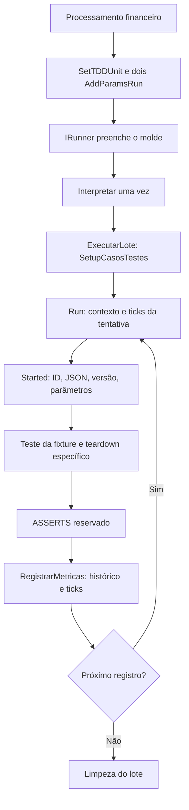

# Análise do diff e da documentação TDD

Data: 2026-10-06. Referência: issue [#22](https://github.com/ModulosTestesAutomatizados/TestesAutomatizadosERP/issues/22). Escopo: análise e especificação, sem alterar o portal ou os fontes Pascal.

## Conclusão

O conteúdo existente permite construir um portal estático com Vue, PrimeVue e Vue Router via CDN. A migração precisa corrigir o contrato documentado, além de substituir a apresentação. Os HTMLs misturam o Runner anterior, o Faturamento que ainda controla sua própria suíte e a refatoração por lote. Converter esses HTMLs diretamente em componentes perpetuaria contradições.

O Runner em `docs/assets/emDesenvolvimento/Runner/` será a referência principal da evolução arquitetural, identificado como **Em desenvolvimento**. Fonte local, requisito planejado e comportamento homologado no ERP são evidências diferentes. A publicação de documentação não conclui a refatoração nem comprova funcionamento no host.

## 1. O que está no Git

Snapshot inicial: branch `master`, HEAD `47fbbbb`. Nenhuma alteração staged. `git diff` contém apenas `.codex/config.toml` e `docs/MER.md`: 3 inserções e 6 exclusões.

| Material | Estado inicial | Avaliação |
| --- | --- | --- |
| `.codex/config.toml` | Modificado | Remove configuração desabilitada de Context7. Configuração de ferramenta, separada da documentação; não representa mudança no ERP. O Context7 disponível na sessão foi consultado. |
| `docs/MER.md` | Modificado | Renomeia a representação de `LOGS_FALHAS_HE` para `LOGS_PROCESSAMENTO_HE`, com aviso de migration ainda não executada. Não comprova schema aplicado. |
| `Documentacoes/` | 5 HTMLs untracked | Conteúdo editorial novo que não aparece em `git diff --stat`. É a principal base para migração. |
| `docs/grafoFaturamento_DocumentoFatura_PedidoVenda.html` | Untracked | Contém dependências, fluxo de execução e cadeia de validação. Migrar diagramas, não repetir uma segunda aplicação HTML. |
| `docs/mermaid-pedido-venda.html` | Untracked | Grafo de dependências do Pedido de Venda. Conciliar com o grafo mais completo acima. |
| `docs/mapeamentoUses/REFACTOR_TDD_FINANCEIRO_PILOTO.md` | Untracked | Mapa relevante do fluxo novo e das pendências. Preservar convenção de mapas em Markdown. |
| `Runner/EXAMPLE_RESULTADO_UNIT_PARA_INTERPRETAR.pas` | Untracked | Exemplo antigo e inconsistente; não adotar como molde atual. |
| `.specs/features/tdd-irunner-lote-json/evidencias/codigo-gerado-financeiro.pas` | Untracked | Snapshot intermediário, divergente do molde em limpeza, resumo e ordem de inicialização. Não comprova geração atual. |
| 7 fontes já rastreados de `Runner/` | Sem diff contra HEAD | A refatoração já está no estado atual do repositório. A análise considera seus fontes, não atribui a refatoração inteira ao diff desta sessão. |

`sql/temp-local/` e `*.json` são ignorados pelo `.gitignore`. A migration apontada por `docs/MER.md:5`, `sql/temp-local/migracao_historico_logs_processamento.sql`, **não está presente neste workspace**. O portal deve explicar a alteração prevista sem oferecer um link inexistente ou afirmar execução. O modelo de conteúdo proposto usa módulos `.js`, evitando introduzir arquivos JSON silenciosamente ignorados.

`.specs/STATE.md` contém uma passagem de contexto da feature anterior, com lista de arquivos não commitados que já diverge do status atual. Foi usado como registro de decisões e pendências, não como inventário atual do diff.

## 2. Inventário editorial

| Origem | Extensão aproximada | Conteúdo a reaproveitar | Destino conceitual |
| --- | --- | --- | --- |
| `Documentacoes/index.html` | 117 linhas | Apresentação e acesso às quatro áreas | Visão geral na rota inicial |
| `01-Processo-Runner-Orquestrador/index.html` | 724 linhas | Conceitos, responsabilidades, tempos, histórico e diagnóstico | Arquitetura, Runner, units e observabilidade |
| `02-Caso-de-Teste/index.html` | 733 linhas | Cadastro, sincronização, JSON, resultados esperados e cenários | Guia de autoria e catálogo |
| `03-Parametro/index.html` | 618 linhas | Mapeamento, aplicação, atualização e reconexão | Parâmetros do sistema |
| `04-Documento-Fatura/index.html` | 801 linhas | Documento, itens, componentes, configuração e limitações | Caso Documento Fatura e três cenários de Pedido de Venda |
| `docs/MER.md` | Modelo de dados | Tabelas, relacionamentos e estado da alteração de logs | Modelo de dados |
| `docs/MAPEAMENTO_AST_USES_UNITS/` | Markdown, drawio e HTML | Mapas históricos de dependências | Referências e diagramas com versão identificada |
| `docs/assets/configuracoesGerais/` | Pascal | CASOS_DE_TESTE, CACHE, CONSTANTES, JSON, ODBC e parâmetros | Responsabilidades das units de base |
| `docs/assets/casosTestesFaturamento/` | Pascal | Referências nominais de Documento Fatura/Pedido e JSONs; dez cópias idênticas exigem revisão de origem | Catálogo de Faturamento, com limite da evidência |
| `docs/assets/casosTestesFinanceiro/` e piloto em desenvolvimento | Pascal | Mapeamentos e piloto têm conteúdo específico; sete fontes com nomes distintos repetem conteúdo | Catálogo Financeiro, separando versões e origem |

Os quatro documentos de detalhe repetem Bootstrap 5.3.3, Material Icons, CSS, função `ocultar(id)` e headings com `onclick`. IDs como `definicao`, `art`, `uso`, `conf` e `obs` se repetem. Isso funciona em páginas isoladas, mas cria colisões e estado imperativo ao reunir conteúdos. O esqueleto deve virar componentes com estado Vue e identificação por documento/seção. Os cinco blocos editoriais são úteis: definições, artefatos, uso, configuração e observações.

Não existe portal Vue, `index.html` na raiz ou workflow `.github` no snapshot analisado. Os diagramas HTML atuais carregam Mermaid 10 por uma faixa móvel de versão e usam inicialização no carregamento; a futura aplicação precisa renderizar também depois da navegação.

## 3. Responsabilidades do novo Runner

| Fonte | Responsabilidade observada | Limite |
| --- | --- | --- |
| `P39_PROCESSAMENTO_TDD_FINANCEIRO.pas` | Configura unit do piloto, módulo e área; chama `Executar` | Ativa debug, desativa instruções. Não é a fixture. |
| `TDD_IRUNNER.pas` | `SetTDDUnit`, `AddParamsRun`, preenchimento do molde e uma chamada a `Interpretar` | Exige uma unit e exatamente dois parâmetros. Usa `TStringList`, `CommaText` e `Troca`. |
| `TDD_BASE_UNIT_IRUNNER.pas` | Casca: `Main → ExecutarLote`, carga única, `First/Run/Next`, finalização | É molde com marcadores, não unit executável isoladamente. |
| `TDD_RUNNER.pas` | Carga do conjunto, reinicialização do contexto/histórico e ticks por tentativa | Não implementa asserts. Índice de ticks atual é `NOME_METODO`. |
| `TDD_STARTED.pas` | Lê ID/JSON do registro corrente, valida versão e aplica parâmetros | Não move o cursor nem recarrega o conjunto. Versão é validada antes dos parâmetros. |
| `TDD_LOGS.pas` | Buffer por caso e instruções condicionadas | `FModoDebug` controla inclusão de mensagens; `FExibirInstrucoes` controla exibição separadamente. |
| `TDD_FINISHED.pas` | Insere histórico e ticks com FK retornada | Persistência de asserts está comentada; falha de persistência propaga. |
| `REFACTOR_TDD_FINANCEIRO_PILOTO.pas` | `Teste`, validação financeira, duplicatas receber/pagar, borderôs receber/pagar e teardown | Consome JSON compartilhado, sem carga própria/configuração padrão; não produz comparação de resultados. |

Fluxo local observado:

Esse diagrama resume o caminho nominal. Documentar à parte incompatibilidade, erro de teste, erro de preparação/teardown e persistência. Não inferir que toda falha permite continuar: a casca relança falha de STARTED que não seja incompatibilidade e falha de TEARDOWN (`TDD_BASE_UNIT_IRUNNER.pas:110`); falhas de persistência também saem pelo tratamento externo.

## 4. Divergências que a migração deve resolver

| Prioridade | Evidência | Conclusão editorial |
| --- | --- | --- |
| Alta | HTML Runner:452–454 usa `AddUsesUnit`/`AddMetodo`; IRunner:28/43/48 oferece `SetTDDUnit`/`AddParamsRun`/`Executar` | Exemplo novo usa o contrato de unit única; APIs anteriores ficam apenas em página de legado. |
| Alta | HTML Runner:128 apresenta `Run` com três argumentos; molde:18/21/58 apresenta `ExecutarLote` com dois e `Run` sem argumentos | Separar configuração do lote da tentativa por ID. Descrição não é mais seletor da tentativa corrente. |
| Alta | HTML Runner:699 afirma persistência de asserts; molde:95 e Finished:58 mantêm-na comentada | `SUCESSO` significa término operacional neste fluxo; não comprova aprovação por asserts. |
| Alta | `EXAMPLE...pas:7` chama `Run` com dois argumentos, declaração:11 exige três; :64 usa `LogsFalhas` ausente no record atual | Exemplo não utilizável como receita atual. Há incompatibilidade textual verificável, sem afirmar erro do host que não foi executado. |
| Alta | Evidência de código gerado:46 usa limpezas aninhadas e nil; molde:44 usa sequência interrompida na primeira falha | Snapshots precisam de data/versão e não substituem molde ou geração recente. |
| Alta | HTML Parâmetro:427 afirma exceção engolida; `P39_TDD_PARAMETRO.pas:126` relança exceção | Corrigir texto para propagação de erro de atualização observada no fonte. |
| Alta | HTML Runner diz que todo acesso é ao banco dedicado; unit Parâmetro:116 usa `ExecuteCommand` em tabelas do ERP | Distinguir persistência TDD via ODBC da alteração de configurações e documentos no ERP. |
| Alta | `TearDown_FinalizarParametros` apenas libera CDS; não há restauração em fonte | Não prometer rollback/baseline restaurado. Registrar intenção da spec anterior como pendente. |
| Alta | Piloto:23 diz empresa deve corresponder à atual; validação:53–57 só exige empresa positiva | A igualdade com empresa corrente é requisito pendente; instrução no próprio Pascal não prova implementação. |
| Alta | SHA-256 idêntico em dez arquivos de Faturamento e em sete de Financeiro | Nome do arquivo não comprova responsabilidade. Não usar essas cópias como receitas das units nomeadas sem recuperar/verificar o fonte correspondente. |
| Média | MER:37 usa `INCOMPATIVEL_VERSAO`; Started:101 usa `VERSAO_INCOMPATIVEL` | Documentar ambos e origem; não normalizar o contrato por decisão editorial. |
| Média | HTML Runner:156 menciona índice composto; Runner:189 define `NOME_METODO`; HTML:712 fala de FindKey não inicializado | Rever diagnóstico antigo: o fonte atual atribui a variável antes do case. |
| Média | HTML Caso:82 fala em quatro blobs; `parametros` é seção do JSON de entrada, não quarta coluna blob | Corrigir o modelo para três blobs documentados e uma seção interna. |
| Média | HTML Parâmetro:178/observações diz tudo restrito à empresa, mas CONFIG_SISTEMA não recebe WHERE | Explicar escopo global e escopo por empresa separadamente. |
| Média | CACHE:41 resolve área apenas por descrição; loader:87 rejeita conjunto vazio | Validação de área por módulo e resumo ZERO_CASOS previstos na spec anterior não estão demonstrados nos helpers atuais. |
| Média | O HTML de Documento Fatura descreve `Teste_Executar` percorrendo o CDS; a casca nova também percorre casos | Não mostrar o contrato descrito no HTML como fixture pronta para a casca nova. A rotina não foi localizada nos fontes homônimos duplicados; a hipótese de dois loops exige verificar a origem antes da adaptação. |
| Média | Mapa financeiro usa variantes locais e P39; fontes de mapeamentos possuem prefixo P39 | Explicar variantes de destino e herança de uses do host customizado; nomes cadastrados no BI exigem confirmação. |

A feature documental registra essas diferenças. Corrigir código Pascal, schema ou restauração pertence às features de execução correspondentes.

### Integridade dos fontes de referência

`Get-FileHash -Algorithm SHA256` confirmou dez arquivos em `casosTestesFaturamento/` com hash `1C404DF8220D5871B78A358F7818687CC39B34680468EB480583BB260907DD17`. São os seis arquivos P39 de Documento Fatura/Pedido/validação e os quatro P39 de JSON de cenários/resultado. Todos têm 384 linhas, iniciam com `uses P39_GERAR_FAT_CONFIG_TESTE, P39_FAT_DADOS_TESTE` e executam um gerador de documentos por filtros. As rotinas `Setup`, `Teste_Executar` e `SetCasoTeste` descritas nos HTMLs não estão nesses arquivos. Isso comprova duplicação local; não comprova a causa, nem corrupção das units no ERP/TekStore.

Em `casosTestesFinanceiro/`, sete arquivos possuem o mesmo hash entre si: `P39_REFACTOR_TDD_FIN_INCLUIR_BORDERO_RECEBIMENTO`, `P39_TDD_FIN_CONFIG_FINANCEIRO`, `P39_TDD_FIN_CONTAS_PAGAR`, `P39_TDD_FIN_CONTAS_RECEBER`, `P39_TDD_FIN_INCLUIR_BORDERO_PAGAMENTO`, `P39_TDD_FIN_INCLUIR_BORDERO_RECEBIMENTO` e `P39_TDD_JSON_FINANCEIRO`. Os dois mapeamentos possuem hashes distintos. O piloto em desenvolvimento foi analisado separadamente.

`TDD_FAT_VALIDAR_RESULTADO.pas` sem prefixo P39 é distinto dos dez arquivos repetidos e contém `CompararTempo` e sua chamada. Portanto, a frase do HTML sobre comparação de tempo desativada não pode ser generalizada para toda versão da validação. O futuro documento precisa escolher e identificar a implementação que descreve.

O sincronizador em `configuracoesGerais/sincronizar/persistenciasODBC/P39_TDD_SINCRONIZAR_CASOS_TESTE_REGISTRADOS.pas` confirma os nomes dos três cenários de Pedido. Confirma também `FINANCEIRO/BORDERÔ`, com acento, enquanto o piloto configura `FINANCEIRO/FINANCEIRO`. Os nomes precisam ser preservados conforme cada origem, sem normalização silenciosa.

## 5. Opções de organização

| Opção | Benefício | Custo/limite | Decisão proposta |
| --- | --- | --- | --- |
| SPA estática com catálogo de dados e componentes, CDN e rotas hash | Um layout, integração de diagramas e um snippet por novo documento | Requer revisão editorial e contrato de conteúdo | Recomendada; atende aos pedidos explícitos |
| Cada HTML como componente de página independente | Migração inicial simples | Mantém duplicação e dificulta novas entradas | Não adotar como padrão de autoria |
| Carregar HTML legado ou iframe dentro de Vue | Preserva página antiga rapidamente | Mantém scripts, Bootstrap, IDs e contratos antigos | Apenas referência externa durante migração, sem ser a arquitetura final |

Vite/SFC/gerador de site exigiriam outra cadeia de build e não atendem à preferência por CDN. Componentes `.js` com templates reutilizáveis atendem ao escopo sem backend.

## 6. Publicação e roteamento

O usuário confirmou Pages, `index.html` na raiz como entrada e Vue Router. Proposta: `createWebHashHistory()` sem base fixa, assets relativos e rotas lógicas como `/estrutura/runner` e `/casos/financeiro`. A URL de projeto prevista é `https://modulostestesautomatizados.github.io/TestesAutomatizadosERP/#/estrutura/runner`; é uma URL alvo, **não uma publicação verificada**.

O Pages precisa do arquivo de entrada no topo da origem/artefato. Hash evita a necessidade de reescrita para cada rota. Preferir um artefato de Actions composto apenas dos arquivos do portal; uma configuração de publicação por branch/raiz também é possível, mas expõe todos os arquivos publicáveis dessa origem. Nesta entrega foi especificada a publicação, sem configurar ou disparar deploy.

## 7. Lacunas e limites da evidência

Não foi executado o ERP, banco, parser Mermaid ou navegador. Os HTMLs foram inspecionados estruturalmente e editorialmente; não há certificação visual. Os fontes Pascal e helpers foram lidos para atribuir responsabilidades e detectar contradições, não para homologar runtime. Parte dos fontes homônimos de casos não corresponde ao papel descrito; recuperar suas versões corretas é pendência editorial, sem sincronização externa nesta entrega. A refatoração tem asserts, restauração, conversões JSON/host, identidade do estado compartilhado e migração de schema pendentes. O portal deve tornar essas pendências visíveis.

## Fontes técnicas consultadas

- [Vue: CDN e ausência de build](https://vuejs.org/guide/quick-start.html) e [build de produção](https://vuejs.org/guide/best-practices/production-deployment.html).
- [PrimeVue: CDN e tema](https://primevue.org/cdn). API consultada: `PrimeVue.Config`, `PrimeUIX.Themes.Aura`, registro de componentes da distribuição UMD.
- [Vue Router: instalação](https://router.vuejs.org/installation) e [createWebHashHistory](https://router.vuejs.org/api/functions/createWebHashHistory.html). A busca inicial `/vuejs/vue-router` retornou Vue Router 3/Vue 2; foi descartada e substituída por `/websites/router_vuejs`. A documentação atual de instalação mostra uma linha mais recente do Router; versões exatas compatíveis deverão ser fixadas e provadas no design, sem misturar exemplos de majors.
- [GitHub Pages: arquivo de entrada](https://docs.github.com/en/pages/getting-started-with-github-pages/creating-a-github-pages-site) e [artefato/workflow](https://docs.github.com/en/pages/getting-started-with-github-pages/using-custom-workflows-with-github-pages).

Vue, PrimeVue e Router foram consultados via Context7. Referências GitHub Pages foram lidas na documentação oficial. A análise acima se ancora no snapshot local e no body integral preservado em `issue-22.md`.
