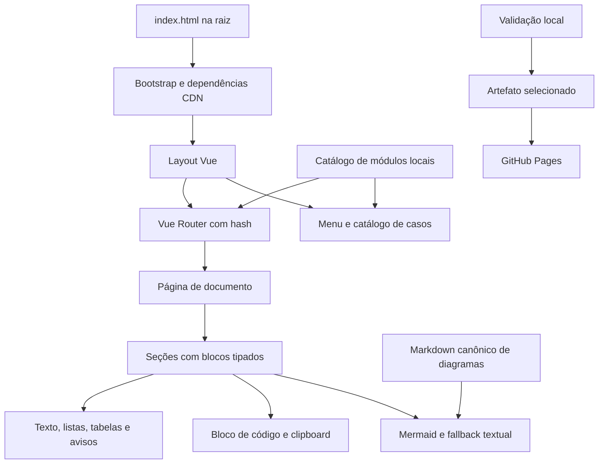

# Design do portal de documentação TDD

**Spec:** [spec.md](spec.md).
**Status:** Draft para revisão do design. A especificação foi aprovada pelo usuário em 2026-10-06 com “Pode seguir!”. Este aceite autoriza avançar o planejamento; não comprova implementação ou publicação.
**Pesquisa:** [Compatibilidade CDN e estado do Pages](evidencias/pesquisa-cdn-pages.md).

## Architecture Overview

A aplicação será uma SPA estática. O `index.html` da raiz carrega dependências CDN fixadas e inicia um módulo local. O Vue Router controla rotas hash. Um catálogo de documentos fornece os dados para páginas genéricas e navegação; componentes pequenos renderizam seções, tabelas, avisos, código e diagramas. Não há backend, API de conteúdo, SFC ou build de frontend.

A abordagem de catálogo e componentes foi proposta na análise e aprovada junto da spec. As alternativas de converter cada HTML em página independente ou embutir HTML legado foram descartadas por manterem duplicação e contratos contraditórios. O design detalha a abordagem aprovada.



O portal registra contratos do ERP; não se conecta a bancos, não sincroniza units e não executa Pascal. A pesquisa não modificou os fontes existentes. `.specs/STATE.md` foi consultado e não possui decisão AD ativa a contrariar; as escolhas deste design ficam no contexto desta feature.

## Dependências fixadas e bootstrap

| Dependência | Versão | Arquivo CDN |
| --- | --- | --- |
| Vue | 3.5.43 | `vue@3.5.43/dist/vue.global.prod.js` |
| Vue Router | 4.6.4 | `vue-router@4.6.4/dist/vue-router.global.prod.js` |
| PrimeVue | 4.5.5 | `primevue@4.5.5/umd/primevue.min.js` |
| PrimeUIX Themes/Aura | 1.2.5 | `@primeuix/themes@1.2.5/umd/aura.js` |
| Mermaid | 11.17.2 | `mermaid@11.17.2/dist/mermaid.min.js` |

Prefixo de todas as URLs: `https://cdn.jsdelivr.net/npm/`. Os bytes, hashes e resultado em Chromium estão na pesquisa. Router 4.6.4 declara compatibilidade com Vue `^3.5.0`. A prova executou Panel, Tag, Button, Message, DataTable e Column, rota hash e geração SVG; não substitui os testes do portal.

O índice contém metadados pt-BR, viewport, CSS local, `#app`, aviso de carregamento, mensagem de falha e `noscript`. Nenhum capítulo ou catálogo reside no índice. As dependências são scripts externos em ordem: Vue, Router, PrimeVue, Aura; o módulo `bootstrap.js` verifica seus globais antes de importar `main.js`. O módulo é envolvido por tratamento de rejeição de import/mount para manter a mensagem de falha visível. A mensagem permanece no HTML mesmo se o módulo não carregar.

Mermaid é dependência opcional do leitor: sua falha não bloqueia o portal. `diagrams.js` inicia um único carregamento de script e compartilha a promessa; rejeição é capturada pelo componente e preserva o fonte textual. Os scripts essenciais usam tratamento de erro e a entrada mantém a mensagem definida em DOC-44. Falha de folha de estilos ou conteúdo deve manter a página semanticamente legível.

`main.js` cria a aplicação, configura `PrimeVue.Config` com `PrimeUIX.Themes.Aura`, registra os componentes utilizados e instala o router. A renderização dos templates usa o build completo de produção Vue, não `vue.runtime.*`. Componentes locais são módulos ES com objeto Vue e template em string. Não adicionar Pinia, Vuetify, Bootstrap, ícones/fontes externos ou biblioteca de syntax highlighting nesta entrega.

## Estrutura de arquivos e responsabilidades

| Caminho planejado | Responsabilidade |
| --- | --- |
| `index.html` | Entrada e estados de bootstrap |
| `Documentacoes/app/bootstrap.js` | Verificação de dependências e início com erro visível |
| `Documentacoes/app/main.js` | Instalação Vue/PrimeVue/router |
| `Documentacoes/app/router.js` | Rotas genéricas, títulos e histórico |
| `Documentacoes/app/config.js` | URLs CDN fixadas, repositório de referência e rótulos de estado |
| `Documentacoes/app/components/AppLayout.js` | Estrutura de leitura e menu responsivo |
| `Documentacoes/app/components/DocSection.js` | Seção expansível com heading e ID composto |
| `Documentacoes/app/components/DocBlocks.js` | Dispatch dos seis tipos de bloco |
| `Documentacoes/app/components/DocTable.js` | Tabela reutilizável com cabeçalhos e rolagem própria |
| `Documentacoes/app/components/DocNotice.js` | Aviso reutilizável com PrimeVue Message |
| `Documentacoes/app/components/CodeBlock.js` | Texto literal, botão e estado da cópia |
| `Documentacoes/app/components/MermaidDiagram.js` | SVG por conteúdo, concorrência e fallback |
| `Documentacoes/app/pages/HomePage.js` | Apresentação e acesso às áreas |
| `Documentacoes/app/pages/DocumentPage.js` | Metadados, fontes e seções de qualquer documento |
| `Documentacoes/app/pages/CatalogPage.js` | Lista dos casos cadastrados |
| `Documentacoes/app/pages/NotFoundPage.js` | Mensagem e retorno ao catálogo |
| `Documentacoes/app/content/catalogo.js` | Imports e coleção única dos documentos |
| `Documentacoes/app/content/estrutura/` | Seis documentos de estrutura |
| `Documentacoes/app/content/casos/` | Documento Fatura, três cenários e Financeiro |
| `Documentacoes/app/content/guias/novo-caso.js` | Guia de autoria e checklist |
| `Documentacoes/app/content/legado/runner.js` | APIs e fluxo anteriores |
| `Documentacoes/app/content/validarCatalogo.js` | Função pura compartilhada por testes e publicação |
| `Documentacoes/app/diagrams.js` | CDN Mermaid e leitura de blocos Mermaid dos Markdown locais |
| `Documentacoes/app/clipboard.js` | Cópia exata e resultado sem exceção na interface |
| `Documentacoes/app/styles/portal.css` | Layout, espaçamento, foco e scroll |
| `Documentacoes/app/templates/novo-caso.js` | Snippet copiável, sem import automático no catálogo |
| `Documentacoes/README.md` | Prévia, autoria, testes e publicação |
| `Documentacoes/migracao.md` | Manifesto editorial completo origem/seção/destino/ação |
| `Documentacoes/tools/` | Validação e montagem do artefato |
| `Documentacoes/tests/` | Testes do catálogo e fluxos de navegador |
| `.github/workflows/documentacao-pages.yml` | Validação/artefato e deploy separado |

Os cinco índices antigos serão substituídos por redirecionamentos somente após migrar seus conteúdos e registrar cada heading no manifesto. O conteúdo original será preservado em `Documentacoes/legado-originais/` como referência editorial, excluída da publicação. Como os HTMLs estão untracked, a cópia preservada não pode depender de recuperação via Git.

## Components e interfaces

| Componente/módulo | Interface | Dependências e reutilização |
| --- | --- | --- |
| `AppLayout` | `documentos: Documento[]`; outlet `RouterView` | RouterLink, Button e menu derivado do catálogo |
| `DocumentPage` | Resolve `slug` pela rota; `documento: Documento` | DocSection/DocBlocks; reinicia instância pelo slug |
| `DocSection` | Props `documentSlug`, `secao`; estado `collapsed` local | Panel toggleable; heading/ID sem `onclick` |
| `DocBlocks` | Prop `blocos: Bloco[]`, `documentSlug` | Composição de blocos sem regras ERP |
| `DocTable` | Props `colunas: string[]`, `linhas: string[][]` | DataTable/Column, sem sorting/paging nesta entrega |
| `DocNotice` | Props `severidade`, `texto` | Message, conteúdo escapado |
| `CodeBlock` | Props `codigo`, `linguagem`; estado de mensagem local | Button e `copiarCodigo` |
| `MermaidDiagram` | Props `codigo` ou `fonte`/`indice`; texto alternativo | `carregarMermaid`, `lerDiagrama`; saída SVG apenas |
| `validarCatalogo` | `(documentos: Documento[]) → ErroCatalogo[]` | Puro, sem DOM, filesystem, rede ou Vue |
| `copiarCodigo` | `(texto: string, clipboard: objeto ou undefined) → Promise<{ok: boolean}>` | Preserva bytes e captura rejeição/ausência da API |
| `lerDiagrama` | `({fonte: string, indice: number}) → Promise<string>` | Fetch de Markdown local, extração de fence Mermaid |
| `carregarMermaid` | `() → Promise<MermaidAPI>` | Uma promessa de carregamento por página |

As mensagens dos componentes vêm da spec. Blocos de conteúdo são texto, sem HTML livre ou scripts de documentos antigos. A única inserção de SVG é a saída da biblioteca Mermaid inicializada com `securityLevel: 'strict'`, `startOnLoad: false` e `htmlLabels: false`; não se usa esse canal para texto editorial.

## Data Models

Os tipos abaixo documentam interfaces JavaScript/JSDoc; não introduzem compilação TypeScript.

```typescript
type Estado = 'legado' | 'em-desenvolvimento' | 'validado-no-erp';
type Categoria = 'estrutura' | 'caso' | 'guia' | 'legado';
interface Fonte {
  caminho: string;
  tipo: 'local' | 'externa';
  verificacao?: 'verificada' | 'nao-verificada';
  observacao?: string;
}
interface Documento {
  slug: string;
  categoria: Categoria;
  titulo: string;
  resumo: string;
  estado: Estado;
  modulo?: string;
  area?: string;
  unitEntrada?: string;
  fontes: Fonte[];
  evidenciaValidacao?: { data: string; versaoERP: string; referencia: string };
  secoes: Secao[];
}
interface Secao { id: string; titulo: string; blocos: Bloco[]; }
type Bloco =
  | {tipo: 'paragrafo'; texto: string}
  | {tipo: 'lista'; itens: string[]}
  | {tipo: 'tabela'; colunas: string[]; linhas: string[][]}
  | {tipo: 'codigo'; linguagem: string; codigo: string}
  | {tipo: 'aviso'; severidade: 'info'|'warn'|'error'|'success'; texto: string}
  | {tipo: 'mermaid'; codigo: string}
  | {tipo: 'mermaid'; fonte: string; indice: number};
interface ErroCatalogo { slug: string; campo: string; mensagem: string; }
```

Para documentos `categoria: 'caso'`, todos os campos obrigatórios da spec permanecem exigidos, incluindo módulo, área e unit de entrada. Documentos gerais não inventam módulo de negócio ou unit de entrada; categoria delimita a validação desses campos. O template da spec recebe `categoria: 'caso'` como metadado adicional. Slug continua único globalmente e segue o regex definido na spec.

A função valida dados obrigatórios, strings vazias, enum, categoria, fontes, IDs de seção duplicados, blocos suportados, formato retangular de tabelas e evidência de validação. Fontes locais são conferidas quanto à existência pelo CLI de validação, não pela função pura. Fonte com correspondência de conteúdo não comprovada é marcada `nao-verificada`; ausência de classificação explícita não autoriza tratá-la como verificada. O erro sempre identifica slug e campo; o CLI sai com código não zero.

Estados não são deduzidos dos status do GitHub. Validado no ERP exige evidência identificável; Em desenvolvimento e Legado continuam documentos completos com limitações, não páginas vazias. Um cadastro futuro inclui seu módulo de dados e um import/registro em `catalogo.js`, sem editar componentes/router.

## Navegação e layout

`createRouter` usa `createWebHashHistory()` sem base fixa. A tabela de rotas permanece exatamente a da spec. `/casos/:slug` resolve a coleção filtrada por categoria caso; `/estrutura/:slug` e `/legado/:slug` resolvem suas categorias; `/guias/novo-caso` recebe documento do guia. Um slug válido em outra categoria não passa como caso.

A home é um componente de rota. Cada mudança atualiza título no formato `Título | TDD ERP`. Rota inexistente mostra `Documentação não encontrada`. Links de documentos são RouterLink. Arquivos físicos são resolvidos contra a URL da entrada, removendo fragmento, por `new URL(caminho, baseDaEntrada)`; nunca contra a rota lógica ou a origem `/`.

Desktop: navegação lateral e coluna de leitura, cabeçalho com identificação do portal, título/resumo/estado, índice de seções e fontes. Mobile: botão explícito de menu com estado expandido e fechamento ao escolher rota; conteúdo em uma coluna. Não persistir preferências em localStorage. Textos têm largura confortável; tabelas, diagramas e `pre` têm scroll próprio. Foco é visível. Controles e headings são semânticos, sem depender de cor para distinguir estados.

IDs de seção são `${documentSlug}-${secao.id}`. O slug integra a key da instância da página: navegar não preserva seções de outro documento. O navegador mantém histórico pelo Router. O foco deve alcançar o heading do documento após navegação sem bloquear a leitura por teclado.

## Diagramas, fontes e conteúdo reutilizado

Os mapas em `docs/mapeamentoUses/` permanecem Markdown conforme `.agents/AGENTS.md:110`. O portal pode referenciar um fence desses arquivos diretamente, via bloco `mermaid` com `fonte` e índice. Assim, não cria uma segunda cópia do mesmo grafo em JavaScript. `docs/MER.md` também pode ser lido como fonte Mermaid. O site só faz fetch de arquivos estáticos incluídos no artefato, sem serviço de dados.

Diagramas dos HTMLs ainda sem Markdown canônico serão extraídos e registrados em Markdown de dependências ou fluxo com origem/versão. Labels HTML antigos serão convertidos para texto para funcionar com strict/htmlLabels false; preservar sentido e legenda. Não confundir mapeamento uses com fluxo de execução: devem ter títulos distintos.

O componente observa alterações do código/fonte, espera o container montado e chama `mermaid.render` com ID global único. Mantém geração local para descartar promessa antiga após alteração ou unmount. Cada render usa container temporário próprio e o remove ao finalizar; falhas não deixam o SVG de erro espalhado no documento. Após renderização, insere SVG e chama `bindFunctions` quando fornecido. Falha de CDN, fetch ou sintaxe mostra mensagem e texto disponível; nunca oculta as demais seções.

## Code Reuse Analysis e migração

| Origem existente | Reutilização | Correção/limite |
| --- | --- | --- |
| Cinco HTMLs `Documentacoes/` | Estrutura editorial, tabelas, exemplos e catálogo inicial | Remover Bootstrap/ocultar/onclick; revisar contrato e textos |
| `docs/MER.md` | Modelo de dados e diagrama canônico | Renomeação prevista, migration ausente, status divergentes explícitos |
| `docs/mapeamentoUses/REFACTOR_TDD_FINANCEIRO_PILOTO.md` | Dependências e estado compartilhado do fluxo novo | Separar contrato local da prova no host |
| Dois grafos HTML de Pedido de Venda | Fluxos, dependências e validação | Conciliar versões/labels; extrair para Markdown |
| Runner e piloto Pascal | Responsabilidades, APIs e exemplos de configuração | Não modificar Pascal ou completar pendências |
| Sincronizador | Nome dos cenários e referências às units JSON | `BORDERÔ` e `FINANCEIRO` são áreas distintas por origem |
| Fontes homônimos duplicados | Somente referência nominal com aviso | Não oferecer conteúdo repetido como receita da unit nomeada |
| `TDD_FAT_VALIDAR_RESULTADO.pas` | Documentar esta variante específica | Não generalizar limite de comparação de tempo do HTML antigo |

O catálogo inicial tem cinco entradas de caso: Documento Fatura, Pedido com Desconto Percentual, Pedido por Unidade Fabril, Pedido com Sequência nos Itens e Financeiro. As páginas de cenários identificam o contrato documentado e a origem dos nomes no sincronizador; detalhes não comprovados permanecem marcados, sem inventar JSON válido para as units duplicadas. Financeiro descreve o piloto observado e separa suas relações com o legado.

`migracao.md` terá uma linha para cada heading editorial relevante dos quatro HTMLs: caminho de origem, heading original, rota/seção destino, ação e motivo de correção quando aplicável. Duplicação editorial pode apontar para um único destino. Os cinco redirecionamentos usarão URL relativa à profundidade da pasta e terão anchor visível e fallback sem script; não transportarão Bootstrap/scripts antigos.

## Error Handling Strategy

| Situação | Tratamento | Mensagem/efeito |
| --- | --- | --- |
| Dependência essencial ausente ou import/mount rejeitado | Manter estado de erro do bootstrap | `Não foi possível carregar a documentação. Recarregue a página.` |
| JavaScript desativado | `noscript` | `Ative o JavaScript para acessar a documentação.` |
| Rota/slug/categoria inexistente | Página de retorno | `Documentação não encontrada` e link ao catálogo |
| Mermaid rejeitado ou CDN indisponível | Somente diagrama em fallback | `Diagrama indisponível` e fonte textual disponível |
| Markdown de diagrama ausente | Falha local e referência visível; CLI deve barrar arquivo ausente | Não quebrar o documento; não fabricar diagrama |
| Clipboard ausente/negado | Manter código selecionável | `Selecione o código para copiar` |
| Cópia exata concluída | Mensagem acessível local | `Código copiado` |
| Fonte homônima não verificada | Metadado e aviso editorial | `Fonte não verificada` |
| Registro inválido | CLI reprova com slug/campo | Bloqueia artefato/publicação |

## GitHub Pages e artefato

O repo é público, branch padrão `master`, `has_pages=false`. A credencial disponível tem push/triage, sem admin/maintain. A configuração de origem do Pages requer administrador ou maintainer, conforme a [documentação oficial](https://docs.github.com/en/pages/getting-started-with-github-pages/configuring-a-publishing-source-for-your-github-pages-site). Isso bloqueia habilitar o serviço com a credencial atual, mas não construir/verificar o portal localmente.

O workflow será preparado com PRs somente validando, sem deploy. Deploy fica em job separado, condicionado a execução manual na branch padrão ou integração revisada na branch padrão, usando environment `github-pages`. Permissões do job de validação: `contents: read`. Job de deploy: `contents: read`, `pages: write`, `id-token: write`, com dependência do artefato validado. Ações Pages seguem versões oficiais conferidas na implementação; não habilitar o serviço automaticamente por configuração local.

`prepararPages` copia uma allowlist para `Documentacoes/.pages-output/`: índice raiz, código/CSS/conteúdo/template do app, cinco redirecionamentos e Markdown canônicos usados pelos diagramas. Não incluir toda a árvore `docs` ou o repositório inteiro. Fontes Pascal são links ao repositório, não downloads do artefato. Excluir originais editoriais, pesquisa, `.specs`, configs, SQL, dumps e ferramentas/testes do portal. A validação rejeita dependência estática local que não tenha sido empacotada.

O destino gerado será ignorado no Git. Preparação não transpila nem faz bundle. Prévia do artefato sob `/TestesAutomatizadosERP/` deve reproduzir a base real. Aprovação local não autoriza push nem deploy nesta sessão. O gate DOC-43 só pode ser Verified após acesso real à URL publicada.

## Verificação planejada

Não há suíte frontend adotada no repositório; `.opencode/package.json` pertence à ferramenta de agente, não ao portal. Foi proposta ao usuário a combinação de testes Node para catálogo e Playwright para navegador. A preferência continua pendente de resposta; esta seção é a recomendação técnica, não confirmação.

Testes do catálogo derivam dos campos/estados/IDs da spec e usam runner nativo de Node. Navegador verifica rotas conhecidas, desconhecidas, histórico, reload, prefixo, teclado, mobile, diagramas após navegação/erro, cópia exata/falha, falha de CDN e `noscript`. Registro sintético em cópia de teste prova autoria sem mudar router; não integra publicação.

Testes e tooling podem usar dependências de desenvolvimento isoladas em `Documentacoes/tools/`, sem requisito de npm para executar o site. O `.gitignore` atual ignora todo JSON; caso tooling precise package/lock, criar exceção limitada aos dois manifests dessa pasta e ignorar node_modules. Não alterar a regra global para documentos JSON. Nenhuma instalação de dependência de produto ocorreu nesta etapa.

Revisão editorial verifica responsabilidades contra os fontes selecionados, todos os destinos do manifesto, estado dos casos, referências existentes e marcações Fonte não verificada. Validação final independente segue TLC após implementar/commitar as tarefas, com evidência por AC. Um probe nominal de CDN não satisfaz os 47 ACs.

## Risks & Concerns

| Concern | Evidência | Impact | Mitigation |
| --- | --- | --- | --- |
| Conteúdo duplicado em fontes de casos | `analise.md`, seção Integridade dos fontes | Receitas erradas sob nome correto | Marcar fontes e não inventar conteúdo; recuperação externa fora desta feature |
| Contratos antigos nos HTMLs | HTML Runner:452; molde atual:18 | Copiar API antiga como nova | Página de legado e revisão por fonte |
| Estado compartilhado customizado do host | Mapa financeiro e spec anterior | Promessa funcional sem prova | Descrever como contrato informado/em desenvolvimento |
| Asserts e restauração pendentes | Molde:95; PARAMETRO:198 | `SUCESSO` interpretado como validação completa | Avisos próximos da execução e histórico |
| Dependências CDN grandes/externas | Hashes e tamanhos da pesquisa | Carregamento e falha de rede | Versões fixas, Mermaid sob demanda, mensagens definidas |
| Render de diagrama termina após trocar rota | Componente assíncrono planejado | SVG obsoleto/erro em DOM desmontado | Geração local e limpeza de container próprio |
| IDs/estado dos HTMLs repetidos | `ocultar` e IDs nos quatro documentos | Colisões e expansão incorreta | IDs compostos e estado por componente |
| Paths Windows versus Pages | Arquivos com maiúsculas/prefixos distintos | Funciona local, falha na publicação | Conferir case e prefixo do artefato |
| JSON globalmente ignorado | `.gitignore:2` | Manifests de teste não versionados | Exceções pontuais apenas se tooling adotado |
| Pages desabilitado e falta de admin/maintain | Pesquisa da API | Publicação real bloqueada | Artefato/workflow reviewáveis e configuração pelo responsável |
| HTMLs novos não recuperáveis pelo HEAD | Status inicial untracked | Perda editorial na substituição | Originais preservados antes de redirecionar |

## Tech Decisions

| Decision | Choice | Rationale |
| --- | --- | --- |
| Roteamento | Hash com Router 4.6.4 | Refresh no Pages sem reescrita de servidor |
| Dependências | Vue 3.5.43, PrimeVue 4.5.5, Aura 1.2.5, Mermaid 11.17.2 | Artefatos exatos e combinação provada |
| Conteúdo | Módulos declarativos e seis blocos | Autoria reutilizável, sem build/CMS |
| Diagramas | Markdown canônico selecionado ou código literal do bloco | Mantém convenção existente e evita duplicação |
| Mermaid | Carregamento sob demanda, strict e labels textuais | Falha localizada e compatibilidade com conteúdo revisado |
| Publicação | Artefato de allowlist por Actions | Repo contém materiais que não compõem o portal |
| Dados de negócio | Somente explicação e links | Issue pede documentação estática |

## Design Coverage

| Requisitos | Decisão e verificação correspondente |
| --- | --- |
| DOC-01–DOC-03 | Entrada, CDN fixada, módulos sem build; pesquisa nominal e inspeção do bootstrap |
| DOC-04–DOC-07 | Router/hash/categorias; reload, prefixo, histórico e NotFound |
| DOC-08–DOC-14 | Layout, seis componentes, metadados, estado local, mobile, teclado e título |
| DOC-15–DOC-22 | Documentos obrigatórios, legado separado, pendências, contratos por fonte e validação de evidência |
| DOC-23–DOC-28 | Cinco casos, estrutura comum, cenários confirmados no sincronizador e limites de validação |
| DOC-29–DOC-34 | Render por navegação, legenda, fallback, texto literal e clipboard |
| DOC-35–DOC-39 | Template e guia, catálogo único, CLI e checklist de nova entrega |
| DOC-40–DOC-42 | Manifesto, originais preservados, redirecionamentos e pacote selecionado |
| DOC-43 | Depende de deploy autorizado e habilitação Pages; sem alegar validação local como publicação |
| DOC-44–DOC-46 | Bootstrap/noscript e README de operação |
| DOC-47 | Classificação de fonte e aviso de origem não verificada |

47 requisitos cobertos no design, nenhum marcado Verified. O próximo artefato é o plano de tarefas, após revisão deste design conforme o fluxo TLC solicitado.
