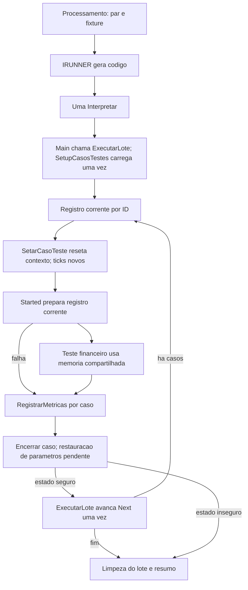

# Design do lote IRunner com JSON compartilhado

**Spec:** `.specs/features/tdd-irunner-lote-json/spec.md`
**Status:** Desenho revisado conforme aprovacoes incrementais do usuario. Implementacao local em andamento; provas nativas pendentes.

**Revisao aprovada em 2026-10-06:** SetupCasosTestes foi transferido para TDD_RUNNER e a Main da casca controla carga/First/loop/Next/limpeza do lote. Run existente, agora sem argumentos, executa somente a tentativa corrente e finaliza seu historico/tempos. Este desenho substitui os trechos anteriores que atribuem carga/iteracao a Run e setup a STARTED. Ver etapa-02-orquestracao-lote.md para implementacao local e limites; restore de parametros e integracao do piloto permanecem pendentes. As demais propostas deste documento nao sao declaradas implementadas.

## Architecture Overview

Recomendo uma interpretacao para o lote, com cursor compartilhado sob controle exclusivo da casca. O gerador monta codigo, STARTED prepara o registro corrente, Teste executa o financeiro e FINISHED persiste. O acoplamento implicito e intencional e tem regras de propriedade de estado.

| Abordagem | Beneficio | Custo | Escolha |
| --- | --- | --- | --- |
| Uma interpretacao e cursor global | Preserva o modelo do ERP e infraestrutura existente | Exige propriedade clara dos globais | Recomendada |
| Uma Interpretar por caso | Isola memoria por invocacao | Nao entrega o mesmo fluxo solicitado | Descartada |
| Copia do lote e contextos independentes | Protege o cursor original | Duplica datasets e responsabilidades | Descartada |

O ponto reservado a asserts permanece sem implementacao. SUCESSO significa conclusao operacional, sem comparacao de resultados. Remover os metodos autorizados nao significa recria-los sob nomes novos.

## Code Reuse Analysis

| Component | Location | How to Use |
| --- | --- | --- |
| Geracao | `Runner/TDD_IRUNNER.pas` | Renomear AddUsesUnit para SetTDDUnit; retirar AddMetodo; Executar gera Teste fixo; manter AddParamsRun |
| Cursor/ciclo | `Runner/TDD_BASE_UNIT_IRUNNER.pas` | ExecutarLote recebe modulo/area e percorre conjunto; Run sem argumentos executa registro corrente |
| Contexto e ticks | `Runner/TDD_RUNNER.pas` | Ajustar SetarCasoTeste e inicializacao/liberacao existentes |
| Preparacao | `Runner/TDD_STARTED.pas` | Started aprovado prepara registro corrente; carga em SetupCasosTestes do Runner |
| Casos/configuracao | `P39_TDD_CASOS_DE_TESTE.pas` | Reusar CDS globais e metodos existentes, inclusive reset e limpeza |
| Resolucao do par | `P39_TDD_CACHE.pas` | Ajustar AreaPeloNome para considerar modulo, propagando assinatura se necessario |
| JSON | `P39_TDD_FUNCOES_JSON.pas` | Reusar assinaturas existentes; nenhuma funcao nova de normalizacao |
| Parametros | `P39_TDD_PARAMETRO.pas` | Reusar VerificarParametros, CriarEstruturaParametrosAtualizar, AtualizarParametros e TearDown_FinalizarParametros |
| Persistencia | `Runner/TDD_FINISHED.pas` | Ajustar RegistrarMetricas existente por tentativa |
| Dominio | `REFACTOR_TDD_FINANCEIRO_PILOTO.pas` | Manter operações financeiras; retirar wrappers JSON e fallbacks autorizados |

## Components

### IRunner e chamador

SetTDDUnit substitui AddUsesUnit e recebe um identificador de unit, mantido em string. Nao ha lista de units, AddMetodo ou lista de metodos. Executar gera uma chamada fixa {UNIT.}Teste sem argumentos, com callback/log/ticks para Teste, dentro do trecho variavel de Run. O comentario identifica a origem; a resolucao executavel permanece implicita conforme contrato do ERP. Interpretar e chamado uma vez por lote.

AddParamsRun conserva os dois argumentos existentes de modulo/area. Conforme nova correcao expressa do usuario, Executar mantem o formato anterior: lLS como TStringList, lMetodo fixo em Teste, Add(CodificacaoUnit), montagem por lLS.Add e substituicoes por Troca. Parametros usam CommaText e a troca global original de virgulas. Foram retirados scanner de nome/literais e validacoes adicionais de molde/marcadores. Mantem somente unit informada e disponibilidade/quantidade dos dois parametros. Nao ha lIndice, pois nao existe mais loop de metodos.

P39_PROCESSAMENTO_TDD_FINANCEIRO.ExecutarIRunner configura SetTDDUnit e os dois parametros; nao registra metodo. Nenhum metodo novo, overload ou adaptador.

### Run e suporte do runner

Main chama somente ExecutarLote(modulo, area). SetupCasosTestes em TDD_RUNNER carrega uma vez; ExecutarLote posiciona First e chama Run para cada registro, avancando Next uma vez. Fixture, STARTED e FINISHED nao recarregam nem movem CDSCasosTestes. O molde conserva duas linhas vazias iniciais.

SetarCasoTeste fica logo depois de SetupCasosTestes e prepara historico, erro, etapa e contexto do registro corrente. InicializarMetricasTickDiff recria tempos por tentativa; LiberarMetricasTickDiff usa Assigned. Metricas permanecem disponiveis ate a proxima inicializacao ou fim do lote.

Run executa STARTED, trecho Teste, ponto reservado a ASSERTS, fechamento dos tempos em aberto e RegistrarMetricas. Falha de teste ou versao incompativel fica no historico e permite o proximo caso. Falha de preparacao ou finalizacao sobe e interrompe. Somente o except externo de Run acrescenta MensagemPersonalizada.

Nao ha flags de telas/setup/continuidade nem acumuladores de erros secundarios. Finally garante chamadas de encerramento; a propagacao normal pode substituir uma exception anterior se a finalizacao falhar. ExecutarLote chama diretamente os teardowns existentes de parametros, cache e estrutura dos casos. O log conserva carregados/tentados/nao tentados usando RecordCount diretamente. Restauracao real de parametros segue pendente, sem confundir Free com restore.

### STARTED e JSON

STARTED aprovado pelo usuario permanece sem alteracoes nesta etapa: prepara ID, descricao e JSON do registro corrente, valida versao com if not e aplica parametros usando os metodos existentes. SetupCasosTestes pertence ao Runner, fora de Run; FEstruturaCasoTesteIniciada permanece no carregador conforme decisao expressa.

As provas de JSON raiz/objeto, normalizacao e pares de parametros continuam pendentes do plano amplo; nao sao declaradas implementadas pela refatoracao do piloto. Piloto usa FUNCOES_JSON nas leituras, sem parser Pos/Copy. Conversao Currency e JSON compacto/formatado exigem prova no host.

### Casos, cache e parametros

Ajustar `AreaPeloNome` existente para considerar o modulo selecionado sem mudar sua assinatura. `ModuloPeloNome` existente guarda o ID resolvido em variavel escalar do cache; `AreaPeloNome` usa esse escopo ao resolver a descricao. SetModulo ja chama ModuloPeloNome antes de SetArea. Para consumidores legados sem escopo selecionado, conservar busca global somente quando a descricao e unica; ambiguidade vira erro explicito, nunca selecao arbitraria. Provar consumidores e reset dessa variavel em T1/T2. Se esse mecanismo nao funcionar no host, expor o conflito antes de trocar assinatura ou propor metodo novo.

Ajustar inicializacao/carga dos CDS existentes para eliminar residuos do lote anterior. Esvaziar casos/resultados antes de preencher. A carga vazia de par valido deve devolver CDS vazio e resumo ZERO_CASOS, distinguindo erro ODBC. Configuracao de modulo desconhecido e erro explicito, sem SQL/configuracao anterior.

Inicializacao parcial precisa ser rastreada por recurso dentro dos metodos existentes. TearDown_Finalizar_CasosTeste tenta liberar cada recurso criado. Cache_TearDown_LimparInformacoes e TearDown_FinalizarParametros recebem o mesmo cuidado de controle de vida. Nao se cria novo metodo de teardown.

Para parametros, capturar baseline real em Setup_Inicializar_Parametros existente e conservar ate o fim do lote. Dentro de VerificarParametros, guardar em CDS de restauracao as chaves tocadas e seus valores originais, usando CriarEstruturaParametrosAtualizar existente para estrutura CHAVE/VALOR. Esse dataset de apoio nao e clone de casos ou configuracao financeira. Guardar chaves antes de iniciar UPDATE permite restaurar tambem falha parcial.

No finally de cada caso, Run devera chamar AtualizarParametros existente (ainda pendente) com o CDS de restauracao, verifica resultado e limpa as chaves daquele caso. No finally do lote, TearDown_FinalizarParametros existente tenta restaurar residuos e libera recursos. O baseline nunca e recapturado a partir de parametros ja alterados. Provar serializacao de strings, numericos e booleanos e leitura real apos Relogar. Sem comprovacao de restauracao, os seguintes IDs ficam nao tentados.

### FINISHED

`RegistrarMetricas` permanece sem nova API. Insere uma vez o historico do ID valido e registra ticks somente do CDS do caso. Falha no INSERT nao pode deixar ID historico anterior nem ligar ticks a ele. Sem ID valido, diagnostico do lote, sem FK ficticia.

Comandos atuais nao demonstram transacao unica de historico e ticks. Manter persistencia parcial explicita: retornar/propagar diagnostico com ID conhecido e fase da falha, sem repetir INSERT ou financeiro. Na implementacao simplificada aprovada, falha de persistencia sobe e interrompe o lote. METRICAS_ASSERTS permanece fora do escopo.

### Piloto: remocoes autorizadas e metodos preservados

Remover exatamente os uses TDD_STARTED, TDD_ASSERTS e TDD_CARREGAR_CASO_TESTE. Permanecem os dois mapeamentos financeiros. Provar que o contexto da casca e visivel na fixture: heranca transitiva nao demonstra por si so visibilidade entre units irmas; esta e a customizacao central informada pelo usuario.

Remover exatamente estas constantes: cModuloFinanceiro, cAreaFinanceiro, cCasoTesteUnico, cTipoDuplicataReceber, cTipoDuplicataPagar, cEtapaDuplicataReceber, cEtapaDuplicataPagar, cEtapaBorderoRecebimento, cEtapaBorderoPagamento, cEtapaFluxoCompleto e cEtapaAtual. Manter cFormReceber, cFormPagar e cDMCadDuplicata. Nao recriar as removidas sob aliases novos.

Remover somente ExecutarFluxoCompletoFinanceiro e Setup. Na revisão posterior, usuário também autorizou remover ExtrairTag, TagJson, ValorInteiroTagLocal, ValorCurrencyTagLocal, PessoaPadraoConfig, ValorPadraoConfig, GRPadraoConfig e ContaBorderoPadrao. Os demais métodos são preservados.

Ajustes previstos nos metodos existentes:

- Main documenta entrada Teste pelo IRunner, sem modulo/area/caso/etapa fixos.
- Teste chama Setup_InicializarObjetos ajustado, executa as quatro operacoes em ordem e usa finally para o TearDown_DestruirObjetos ajustado. Nao chama Setup/Started nem controla carga do lote.
- Setup_InicializarObjetos recebe o JSON compartilhado e chama ValidarCasoTeste; não carrega configurações. Nao cria FCDSCasoTeste/FCDSConfig nem recarrega caso.
- TearDown_DestruirObjetos cancela edicoes/fecha telas utilizadas, se necessario, e nunca libera os CDS compartilhados ou objetos do ERP. Seu nome legado nao autoriza destruir recursos herdados.
- SetCasoTeste ajusta/valida a visao local do JSON quando chamado. O caminho IRunner usa o JSON atual fornecido por STARTED. Sem consumidor conhecido, manter metodo fora do caminho ativo, sem remove-lo.
- Wrappers JSON removidos por autorização posterior; as chamadas usam diretamente FUNCOES_JSON.
- ValidarCasoTeste reseta erro, usa JSON corrente normalizado e valida EMPRESA_DUP/TIPODOC_DUP; falha levanta excecao em Teste antes de gravacao. Nao usar envio de mensagem como criterio de sucesso.
- _IncluirDuplicata conserva parametro pTipo e usa codigos de dominio existentes 0/1 nas duas chamadas e na decisao de receber/pagar; sem novas constantes/metodos. Esses valores apenas substituem os aliases removidos, sem mudar semantica.
- Operacoes de bordero iniciam VlrPagar em zero, limpam selecao por chamada e fecham UI em finally. Limpeza que falhar essencialmente impede continuação segura.
- ObterResultadoEsperado usa CDSResultadoEsperado pelo ID corrente se chamado, sem mover CDSCasosTestes. ObterResultadoAtual permanece fora do caminho ativo de Teste; seus true constantes nao sao evidencia funcional. Nao adicionar asserts ou reescrever contrato de comparacao.

Variaveis duplicadas de dataset podem ser retiradas se deixarem de ser usadas, pois a restricao e sobre metodos. A implementacao desta etapa usa FCasoTesteAtualJson diretamente, sem FJSONCasoTeste local. Nenhum method sera removido por ficar sem chamadas.

A remocao do seletor implica sequencia completa de Teste. Esta e uma interpretacao explicita para revisao, sem novo seletor de etapas.

## Data Models

Nenhum schema novo. Durante tentativa, ID em CDSCasosTestes, FCasoTesteAtualId e FHistoricoExecucao.AutoIncCasoTeste devem coincidir. Resultado esperado permanece em CDS separado por ID.

| Recurso | Vida | Proprietario |
| --- | --- | --- |
| Listas de montagem | Geracao | IRunner |
| CDS casos/resultados/configuracao e cache | Lote | Infraestrutura; ExecutarLote encerra por metodos existentes |
| Baseline de parametros | Lote | Parametros |
| Chaves a restaurar | Caso, conservadas se restore falha | Parametros |
| Historico/metodo/etapa/ticks | Caso | Runner |
| Forms, DMs e CDS nativos | Sessao ERP | ERP; fixture usa/cancela/fecha, nao libera |

## Contrato JSON e fallbacks

Reusar APIs atuais: ValorInteiroTag(json, tag, default), ValorCurrencyTag(json, tag, default), ValorStringTag(json, tag), ValorLogicoTag(json, tag, default), ValorDataTag(json, tag), GetPairName(pair), GetPairValue(pair). Sem normalizador novo. ValorCurrencyTag exige prova nativa de Currency e locale; somente corrigir implementacao compartilhada se evidencia demonstrar falha, preservando assinatura sempre que possivel.

| Tag | Regra |
| --- | --- |
| EMPRESA_DUP | ValorInteiroTag com default 0; obrigatorio positivo e igual a Codigo_Empresa_Atual; sem trocar empresa |
| TIPODOC_DUP | ValorInteiroTag com default 0; obrigatorio positivo conforme regra atual |
| PESSOA_DUP | Obrigatório; zero, ausente ou inválido gera exception |
| VALOR_DUP | Obrigatório; zero, ausente ou inválido gera exception |
| GRUPORESULTADO_DUPGR | Obrigatório; zero, ausente ou inválido gera exception |
| CONTA_BORD | Obrigatório; zero, ausente ou inválido gera exception |
| QUALIFICACAO_DUP | Aplicar somente positivo |
| PESSOANOTACREDITO_BORD | Aplicar somente positivo |
| PRAZOVENCIMENTO_DUP | Hoje mais prazo, default 0 |

QUALIFICACAO_DUP, PESSOANOTACREDITO_BORD e PRAZOVENCIMENTO_DUP conservam os defaults existentes por confirmação expressa do usuário. Obrigatorios com default 0 falham. TagExiste nao prova presenca estrutural/tipo pois vazio retorna False. Prova nativa exige: 1234.56 vira valor numerico 1234.56, 0 permanece 0, inteiro 30 vira 30, false vira False, invalidos numericos retornam default informado, e JSON compacto/formatado equivalente fornece mesmos dados apos normalizacao. Campos de precondicao nao usam default positivo.

## Error Handling Strategy

| Cenario | Resultado |
| --- | --- |
| Geracao invalida | Zero Interpretar e limpeza de listas |
| Falha de carga | Diagnostico do lote e limpeza parcial; sem historico ficticio |
| JSON/versao/precondicao invalidos | Finalizar tentativa do ID sem financeiro; proximo se seguro |
| Falha financeira | Preservar causa, finalizar e tentar proximo se seguro |
| Persistencia parcial | Informar ID e fase, sem retry; resumo com erro de infraestrutura |
| Parametro/UI/cursor nao restauravel | Interromper e listar nao tentados |
| Callback/liberacao falha | Finally tenta os demais encerramentos; exception interrompe |

Resumo em log: carregados = tentados + nao tentados, sem novos contadores. SUCESSO nao significa aprovado por asserts; ZERO_CASOS e resumo, sem novo status gravado no schema.

## Risks & Concerns

| Concern | Location (file:line) | Impact | Mitigation |
| --- | --- | --- | --- |
| Recarga move cursor | `Runner/TDD_STARTED.pas:68` | Repete/pula casos | Started aprovado usa registro atual; carga no Runner |
| Lote anterior permanece | `P39_TDD_CASOS_DE_TESTE.pas:103` | Caso de outro par | Esvaziar/reiniciar infraestrutura |
| Area ambigua | `P39_TDD_CACHE.pas:53` | Par incorreto | Resolucao no modulo; propagar assinatura existente |
| Parametros persistem | `manipulacaoParametros/P39_TDD_PARAMETRO.pas:100` | Contamina caso seguinte | Baseline e restore via AtualizarParametros existente |
| JSON oculta falha | `P39_TDD_FUNCOES_JSON.pas:26` | Default aparenta dado | Provas de normalizacao pendentes; obrigatorios positivos no piloto |
| Currency/locale | `P39_TDD_FUNCOES_JSON.pas:39` | Compilacao/conversao | Prova nativa antes de migrar chamadas |
| Tick por nome | `Runner/TDD_RUNNER.pas:90` | TOTAL colide | Reinicializar por caso |
| Inicializacao parcial | `P39_TDD_CASOS_DE_TESTE.pas:184` | Vazamento/Free indevido | Assigned e rotinas existentes; prova de vida no host |
| Finally interrompe limpeza | `Runner/TDD_BASE_UNIT_IRUNNER.pas:58` | Mascara erro | Tentativas independentes dentro de Run |
| Persistencia parcial | `Runner/TDD_FINISHED.pas:34` | Historico incompleto | Diagnostico com ID e sem retry |
| Units irmas/variantes | `REFACTOR_TDD_FINANCEIRO_PILOTO.pas:1` | Contexto nao visivel | Prova T1 e inventario de nomes runtime |
| Borderos marcam todos titulos da pessoa | `REFACTOR_TDD_FINANCEIRO_PILOTO.pas:280` | Efeitos entre casos | Massa dedicada e validar filtros antes de executar lote real |
| Assinaturas compartilhadas | `P39_TDD_CACHE.pas:53` | Consumidores remotos quebrados | Inventario de consumidores antes de propagar; se exigir novo metodo, perguntar antes |

## Tech Decisions

Um Interpretar por lote; ID como identidade; cursor exclusivo; resources por lote/caso; restore de parametros; sem retry; apenas ajustes nos metodos existentes. Contratos de unit unica, fluxo incremental e simplificacoes foram aprovados pelo usuario; demais propostas indicadas como pendentes nao estao implementadas. `.specs/STATE.md` nao existia e nao havia AD ativo no estudo. O historico MVP permanece preservado.

## Compatibilidade e entrega posterior

TDD_* e desenvolvimento local; P39_TDD_* e dependencia remota conforme `.agents/AGENTS.md`. Nao duplicar variantes ou inferir identidade entre nomes diferentes. Inventariar CodificacaoUnit, alias de logs/cache e dependencias de mapeamento no ERP.

Nao criar nem remover outro metodo sem pergunta justificada e aceite expresso. Se adaptar uma assinatura existente afetar consumidores remotos nao inventariaveis, expor o conflito antes de implementar, com alternativas concretas. Nao ha necessidade comprovada de metodo novo neste plano.

Revisar pacote local coerente antes de publicacao futura autorizada. Recarregar units no BI para evitar cache antigo. Reverter arquivos nao desfaz documentos financeiros; massa de homologacao e baseline de parametros sao necessarios. Provas usam ajustes temporarios em copias dos metodos existentes, nunca novos metodos de fixture.

## Etapa 06: encerramento financeiro

Teste define TEARDOWN no campo existente FNomeMetodoAtual antes de chamar TearDown_DestruirObjetos; somente apos sucesso retorna para IRUNNER. Run reconhece TEARDOWN como exception fatal. Nao ha outro flag de continuidade. TearDown percorre os quatro formularios financeiros conhecidos, cancela cadastro em edicao e fecha a tela, sem destruir objetos herdados. Pagamento mapeia componentes/inicia cadastro sem CriarObjetos, evitando seus dez datasets temporarios. Provas dos mapeamentos e da limpeza real continuam pendentes no ERP.

## Logs individuais e instruções

Run cria/limpa FLogsCasoTeste na entrada, registra delimitadores e delega a captura de Text para LogsProcessamento em Finished, imediatamente antes do INSERT. Finalmente limpa o texto da tentativa e ExecutarLote libera a lista. Sem debug, o histórico recebe log vazio. O snapshot contém mensagens até a entrada de FINISHED; diagnósticos emitidos depois dessa cópia não entram no INSERT já preparado. Nenhuma query adicional de atualização do histórico foi introduzida.

Não existem chamadas aos quatro métodos de exibição de debug nos arquivos Pascal locais. Após inventário, suas procedures foram removidas de TDD_LOGS por autorização expressa. MostrarInstrucoesUnit permanece: somente FExibirInstrucoes decide mostrar instruções. Código gerado, SQL e dados de CDS são registrados como mensagens textuais/resumos, sem popups de diagnóstico no fluxo local. Forms financeiros e callbacks operacionais continuam existentes.

## Etapa 09: piloto com seis procedures

Autorização posterior substitui a preservação anterior dos produtores de resultado e SetCasoTeste. Piloto contém Main, ValidarCasoTeste, Teste, _IncluirDuplicata(pTipo), _IncluirBordero(pTipo) e TearDown_DestruirObjetos. Nenhum método de asserts foi implementado. Seleção da pessoa é parte do pagamento. _IncluirBordero tem dois caminhos com os filtros, mapeamentos, totais e gravações anteriores; o acumulador começa em zero para cada chamada. A validação específica não foi movida para infraestrutura genérica.

Instruções usam delimitadores de 116 caracteres de = e operadores de quebra na mesma coluna. O último operador de concatenação não fica sem operando. Exibição permanece via MostrarInstrucoesUnit/FExibirInstrucoes.

## Etapa 10: encerramento sequencial

Por solicitação expressa posterior, ExecutarLote não usa finally aninhados para cada limpeza. Métricas, parâmetros, cache, casos e logs são encerrados em sequência com except único. Falha recebe contexto e interrompe chamadas restantes. A garantia anterior de tentar todos os recursos não se aplica a este bloco. Não foram alterados os métodos de limpeza ou Run.

## Etapa 11: captura no ponto de persistência

THistoricoExecucao contém LogsProcessamento. SetarCasoTeste limpa esse campo por tentativa. Finished insere LOGS_PROCESSAMENTO_HE com :LogsProcessamento e recebe o texto acumulado logo antes de TDDScalarODBCP. Base não captura mais os logs. Migration renomeia a coluna existente, sem recriação. Aplicação no banco e validação nativa continuam pendentes.

A captura anterior ao INSERT não inclui diagnósticos emitidos depois; preservar essas mensagens no mesmo registro depende de decisão sobre um UPDATE adicional. Nada foi acrescentado aos comandos de métricas/ASSERTS nesta etapa.

## Etapa 12: somente logs da execução

Finished não emite novos logs de persistência. Copia o texto acumulado para LogsProcessamento antes do INSERT e persiste as métricas, propagando exceptions. Run limpa a lista no finally externo após a tentativa e novamente na entrada, preservando a separação entre casos. Nenhum UPDATE de logs necessário para esta política.
