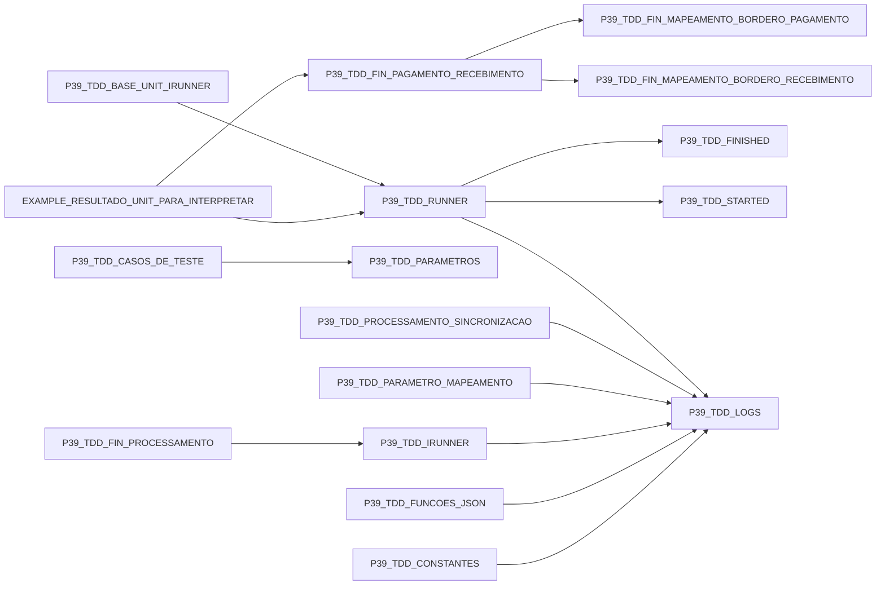

# Impacto local da renomeação de units

Somente cláusulas uses dos fontes locais. SetTDDUnit e CodificacaoUnit são referências dinâmicas, listadas separadamente no guia.

## Evidência dos consumidores

- `docs/assets/emDesenvolvimento/Runner/EXAMPLE_RESULTADO_UNIT_PARA_INTERPRETAR.pas:3`: `EXAMPLE_RESULTADO_UNIT_PARA_INTERPRETAR` usa `P39_TDD_FIN_PAGAMENTO_RECEBIMENTO`.
- `docs/assets/emDesenvolvimento/Runner/EXAMPLE_RESULTADO_UNIT_PARA_INTERPRETAR.pas:3`: `EXAMPLE_RESULTADO_UNIT_PARA_INTERPRETAR` usa `P39_TDD_RUNNER`.
- `docs/assets/emDesenvolvimento/Runner/P39_TDD_BASE_UNIT_IRUNNER.pas:3`: `P39_TDD_BASE_UNIT_IRUNNER` usa `P39_TDD_RUNNER`.
- `docs/assets/configuracoesGerais/P39_TDD_CASOS_DE_TESTE.pas:1`: `P39_TDD_CASOS_DE_TESTE` usa `P39_TDD_PARAMETROS`.
- `docs/assets/configuracoesGerais/P39_TDD_CONSTANTES.pas:1`: `P39_TDD_CONSTANTES` usa `P39_TDD_LOGS`.
- `docs/assets/emDesenvolvimento/P39_TDD_FIN_PAGAMENTO_RECEBIMENTO.pas:2`: `P39_TDD_FIN_PAGAMENTO_RECEBIMENTO` usa `P39_TDD_FIN_MAPEAMENTO_BORDERO_PAGAMENTO`.
- `docs/assets/emDesenvolvimento/P39_TDD_FIN_PAGAMENTO_RECEBIMENTO.pas:1`: `P39_TDD_FIN_PAGAMENTO_RECEBIMENTO` usa `P39_TDD_FIN_MAPEAMENTO_BORDERO_RECEBIMENTO`.
- `docs/assets/emDesenvolvimento/Runner/P39_TDD_FIN_PROCESSAMENTO.pas:3`: `P39_TDD_FIN_PROCESSAMENTO` usa `P39_TDD_IRUNNER`.
- `docs/assets/configuracoesGerais/P39_TDD_FUNCOES_JSON.pas:1`: `P39_TDD_FUNCOES_JSON` usa `P39_TDD_LOGS`.
- `docs/assets/emDesenvolvimento/Runner/P39_TDD_IRUNNER.pas:1`: `P39_TDD_IRUNNER` usa `P39_TDD_LOGS`.
- `docs/assets/configuracoesGerais/manipulacaoParametros/P39_TDD_PARAMETRO_MAPEAMENTO.pas:1`: `P39_TDD_PARAMETRO_MAPEAMENTO` usa `P39_TDD_LOGS`.
- `docs/assets/configuracoesGerais/Sincronizar/P39_TDD_PROCESSAMENTO_SINCRONIZACAO.pas:3`: `P39_TDD_PROCESSAMENTO_SINCRONIZACAO` usa `P39_TDD_LOGS`.
- `docs/assets/emDesenvolvimento/Runner/P39_TDD_RUNNER.pas:1`: `P39_TDD_RUNNER` usa `P39_TDD_FINISHED`.
- `docs/assets/emDesenvolvimento/Runner/P39_TDD_RUNNER.pas:1`: `P39_TDD_RUNNER` usa `P39_TDD_LOGS`.
- `docs/assets/emDesenvolvimento/Runner/P39_TDD_RUNNER.pas:1`: `P39_TDD_RUNNER` usa `P39_TDD_STARTED`.
