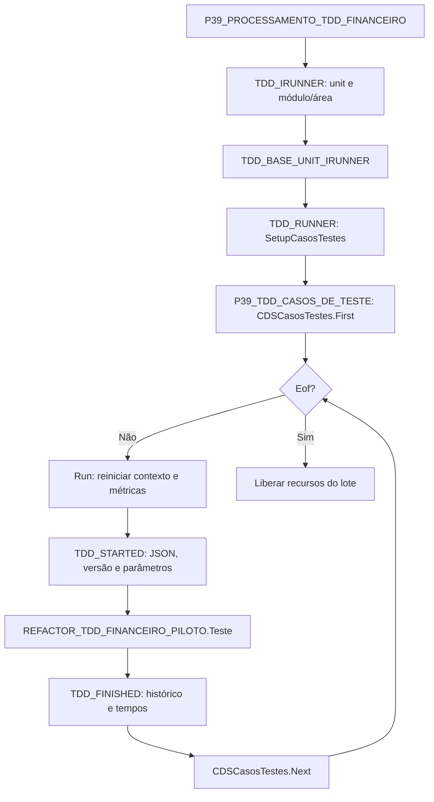

# Inventário e lote com IRunner

Fontes: `P39_PROCESSAMENTO_TDD_FINANCEIRO.pas`, `TDD_IRUNNER.pas` e `TDD_BASE_UNIT_IRUNNER.pas` em `docs/assets/emDesenvolvimento/Runner/`.

Este diagrama descreve o caminho normal. As decisões de falha e continuidade estão nos diagramas canônicos do Runner.
