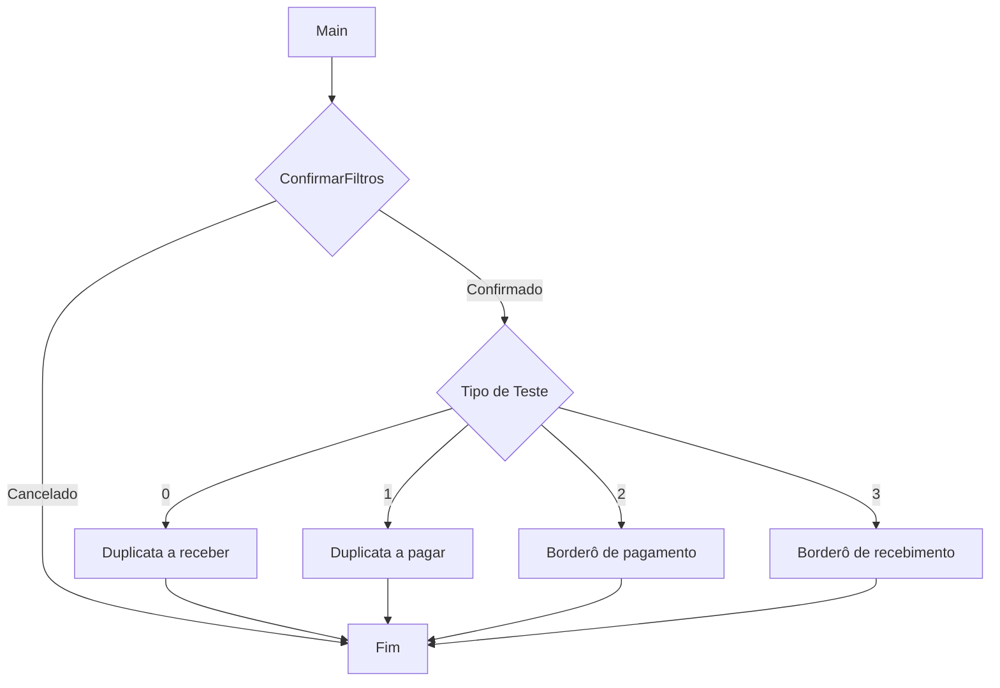

# Entrada financeira do contrato anterior

Fonte: `docs/assets/casosTestesFinanceiro/processamentos/InclusaoDeDuplicatas.pas`.
As chamadas abaixo pertencem ao processamento; os arquivos locais das units apresentam divergências descritas na documentação.

