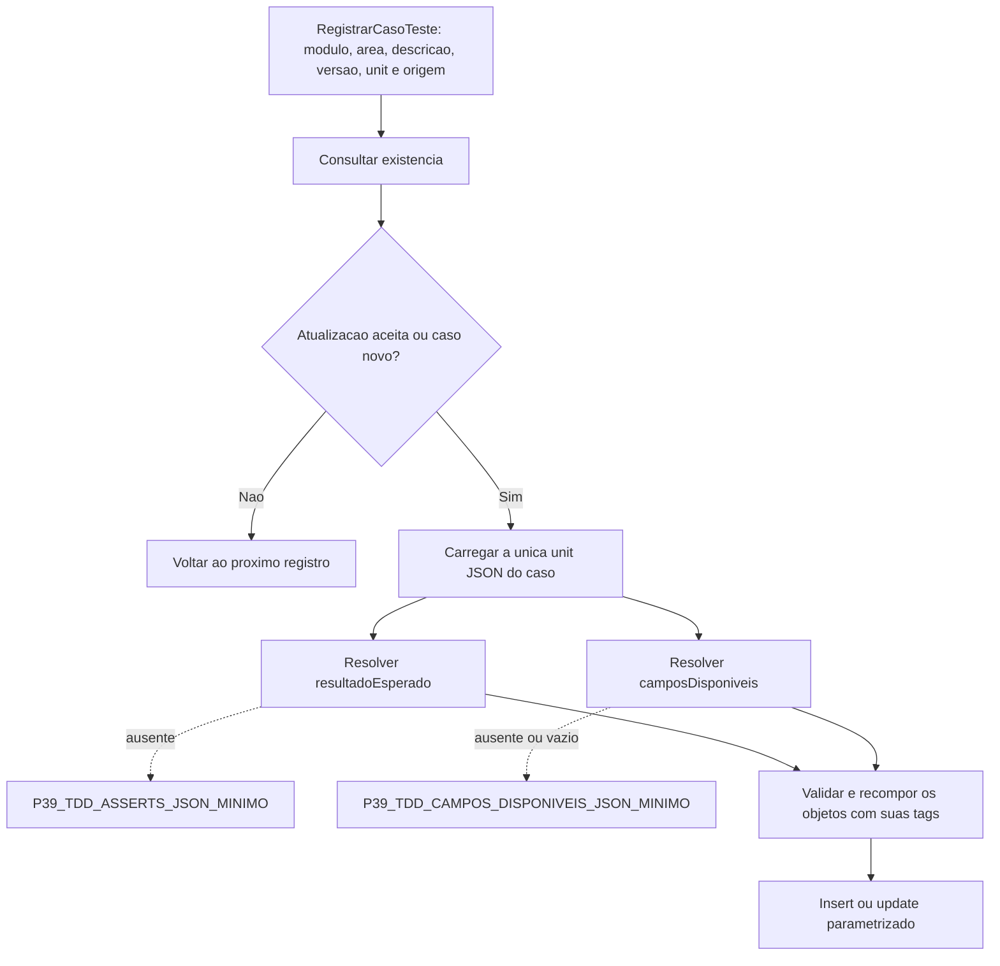

# Sincronização da fonte única

resultadoEsperado explicitamente vazio não usa mínimo. parametros ausente não é sintetizado. Os dois mínimos usam suas units remotas também quando a fonte principal é local.
