# Grafo AST de uses: P39_TDD_PROCESSAMENTO_SINCRONIZACAO, P39_TDD_SINCRONIZAR_CASOS_TESTE_REGISTRADOS

```mermaid
flowchart LR
  P39_TDD_CONSTANTES["P39_TDD_CONSTANTES"]
  P39_TDD_FUNCOES_JSON["P39_TDD_FUNCOES_JSON"]
  P39_TDD_ODBC["P39_TDD_ODBC"]
  P39_TDD_PROCESSAMENTO_SINCRONIZACAO["P39_TDD_PROCESSAMENTO_SINCRONIZACAO"]
  P39_TDD_RUN_LOGS["P39_TDD_RUN_LOGS · variante de arquivo"]
  P39_TDD_SINCRONIZAR_CASOS_TESTE_REGISTRADOS["P39_TDD_SINCRONIZAR_CASOS_TESTE_REGISTRADOS"]
  TDD_REGISTRAR_CASO_TESTE["TDD_REGISTRAR_CASO_TESTE · variante de arquivo"]
  P39_TDD_CONSTANTES --> P39_TDD_RUN_LOGS
  P39_TDD_FUNCOES_JSON --> P39_TDD_RUN_LOGS
  P39_TDD_ODBC --> P39_TDD_CONSTANTES
  P39_TDD_PROCESSAMENTO_SINCRONIZACAO --> P39_TDD_SINCRONIZAR_CASOS_TESTE_REGISTRADOS
  P39_TDD_SINCRONIZAR_CASOS_TESTE_REGISTRADOS --> TDD_REGISTRAR_CASO_TESTE
  TDD_REGISTRAR_CASO_TESTE --> P39_TDD_FUNCOES_JSON
  TDD_REGISTRAR_CASO_TESTE --> P39_TDD_ODBC
```

Inventário: sincronizacao.ast.json. Somente cláusulas uses do fonte; comentários/literais são mascarados. Variantes P39_ são candidatas locais explícitas e não prova de cadastro remoto. Nós não resolvidos não recebem hash de um fonte de nome diferente. Carga dinâmica e estado compartilhado estão em mapas separados.
