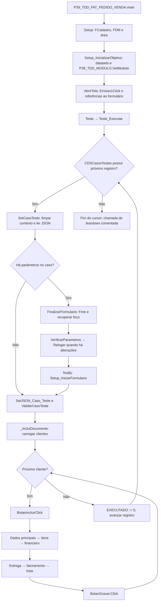

# Pedido de Venda — execução do contrato refatorado

Baseado no fluxo documentado por TEK-JoaoPauloJaques no PR #20 e nos fontes de referência incorporados. O cursor pertence a Teste_Executar; a unit ainda não usa o cursor do molde IRunner.

