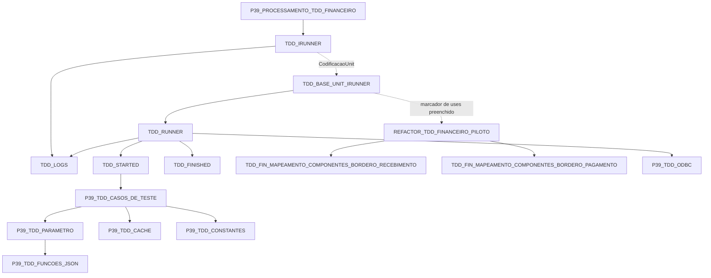

# Dependências do piloto financeiro no fluxo IRunner

O piloto tem entrada `Teste`, chamada pela casca gerada. O processamento configura TDD_IRUNNER diretamente. O estado compartilhado depende do contrato customizado do host ERP; o grafo de uses não comprova essa visibilidade por si só.

## Origem do estado consumido

| Estado/metodo | Origem | Uso no piloto |
| --- | --- | --- |
| FCasoTesteAtualId / FCasoTesteAtualJson | TDD_STARTED | Registro preparado para a tentativa corrente |
| ValorStringTag / ValorInteiroTag / ValorCurrencyTag | P39_TDD_FUNCOES_JSON, via PARAMETRO | Leitura compartilhada de JSON |
| FLogsCasoTeste / RegistrarLogEmModoDebug / DelimitadorLog | TDD_LOGS | Registro de mensagens por tentativa, somente com debug |
| FNomeMetodoAtual | TDD_RUNNER | TEARDOWN permite interromper quando a limpeza financeira falha |
| Forms, DMs e CDS financeiros | ERP, via mapeamentos | Telas encerradas, edições canceladas; datasets compartilhados não são destruídos pelo piloto |

## Nomes locais e externos

TDD_RUNNER, TDD_IRUNNER, TDD_STARTED e TDD_FINISHED estão em `docs/assets/emDesenvolvimento/Runner`. Os mapeamentos preservam os nomes TDD existentes no uses do piloto; os fontes de referência no workspace usam o prefixo P39 em `docs/assets/casosTestesFinanceiro/`. O inventário sintático mantém esses nomes externos separados, sem afirmar identidade entre as variantes.

As dependências P39 globais têm fontes de referência no workspace e são integradas pelo host. O grafo não afirma que o JvInterpreter padrão disponibiliza globais entre units irmãs: essa visibilidade vem da customização do ERP. Nenhum uses redundante foi acrescentado ao piloto.

## Propriedade e limites

ExecutarLote controla carga, cursor e limpeza dos CDS compartilhados. Teste valida o JSON, executa as quatro operações financeiras e chama TearDown_DestruirObjetos em finally. O teardown cancela edições e fecha os quatro formulários financeiros, sem liberar os CDS compartilhados. O pagamento usa MapearComponentesBorderoPagamento e IniciarCDSCadastroBordero existentes, sem chamar CriarObjetos.

Asserts permanecem pendentes; resultados/comparações pertencem a essa etapa. Restauração de parâmetros, conversões JSON no host e comportamento dos mapeamentos sob falhas continuam sem homologação comprovada nesta documentação.

O piloto não depende mais de CDSConfiguracao/CarregarConfiguracoes ou fallbacks: pessoa, valor, grupo de resultado e conta vêm do JSON e geram erro quando ausentes/inválidos/zerados. Qualificação, pessoa da nota de crédito e prazo continuam opcionais. Wrappers locais foram retirados por autorização expressa.

Piloto passa a ter seis procedures. _IncluirBordero(pTipo) centraliza recebimento (0) e pagamento (1), mantendo as operações próprias de cada caminho. Seleção da pessoa está incorporada ao pagamento. Validação do JSON é específica e chamada diretamente por Teste; teardown permanece no final.
