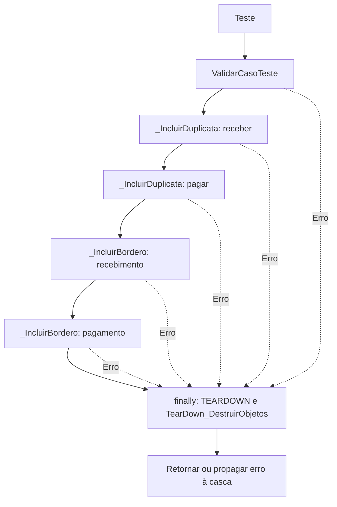

# Sequência do piloto financeiro

Fonte: `docs/assets/emDesenvolvimento/P39_TDD_FIN_PAGAMENTO_RECEBIMENTO.pas`, procedure `Teste`.
O finally executa a limpeza mesmo quando validação ou operações falham.

