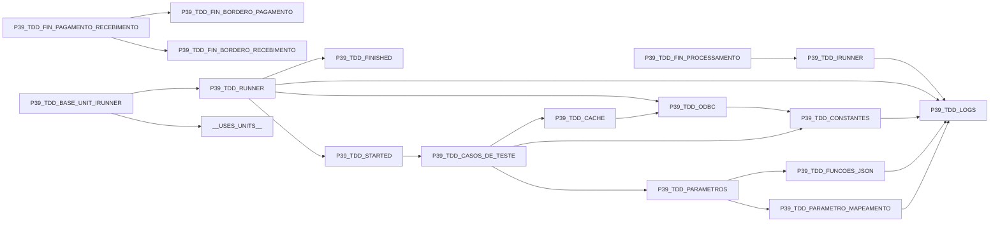

# Grafo de uses do IRunner

Inventário: `P39_TDD_IRUNNER.ast.json`. Comentários e strings Pascal não são cláusulas uses.

SetTDDUnit seleciona P39_TDD_FIN_PAGAMENTO_RECEBIMENTO; essa dependência dinâmica não é uma cláusula uses do orquestrador.
