# TDD_IRUNNER — mapa sintático de uses

Gerado por `python Documentacoes/tools/uses_graph.py`. Não editar manualmente.

A árvore cobre cláusulas uses, arquivo e linha. Não é uma AST completa de Delphi.
Setas sólidas: uses diretos; cadeias: herança transitiva. Setas pontilhadas: molde carregado ou marcador dinâmico.
Azul: fonte local; cinza: unit externa/não resolvida; amarelo: marcador dinâmico.
Os prefixos locais e remotos são preservados, sem inferir equivalência.

```mermaid
flowchart LR
    P39_PROCESSAMENTO_TDD_FINANCEIRO["P39_PROCESSAMENTO_TDD_FINANCEIRO"]:::local
    P39_TDD_CACHE["P39_TDD_CACHE"]:::local
    P39_TDD_CASOS_DE_TESTE["P39_TDD_CASOS_DE_TESTE"]:::local
    P39_TDD_CONSTANTES["P39_TDD_CONSTANTES"]:::local
    P39_TDD_FUNCOES_JSON["P39_TDD_FUNCOES_JSON"]:::local
    P39_TDD_LOGS["P39_TDD_LOGS"]:::external
    P39_TDD_ODBC["P39_TDD_ODBC"]:::local
    P39_TDD_PARAMETRO["P39_TDD_PARAMETRO"]:::local
    P39_TDD_PARAMETRO_MAPEAMENTO["P39_TDD_PARAMETRO_MAPEAMENTO"]:::local
    REFACTOR_TDD_FINANCEIRO_PILOTO["REFACTOR_TDD_FINANCEIRO_PILOTO"]:::local
    TDD_BASE_UNIT_IRUNNER["TDD_BASE_UNIT_IRUNNER"]:::local
    TDD_FINISHED["TDD_FINISHED"]:::local
    TDD_FIN_MAPEAMENTO_COMPONENTES_BORDERO_PAGAMENTO["TDD_FIN_MAPEAMENTO_COMPONENTES_BORDERO_PAGAMENTO"]:::external
    TDD_FIN_MAPEAMENTO_COMPONENTES_BORDERO_RECEBIMENTO["TDD_FIN_MAPEAMENTO_COMPONENTES_BORDERO_RECEBIMENTO"]:::external
    TDD_IRUNNER["TDD_IRUNNER"]:::local
    TDD_LOGS["TDD_LOGS"]:::local
    TDD_RUNNER["TDD_RUNNER"]:::local
    TDD_STARTED["TDD_STARTED"]:::local
    __USES_UNITS__["__USES_UNITS__"]:::dynamic
    P39_PROCESSAMENTO_TDD_FINANCEIRO --> TDD_IRUNNER
    P39_TDD_CACHE --> P39_TDD_ODBC
    P39_TDD_CASOS_DE_TESTE --> P39_TDD_CACHE
    P39_TDD_CASOS_DE_TESTE --> P39_TDD_CONSTANTES
    P39_TDD_CASOS_DE_TESTE --> P39_TDD_PARAMETRO
    P39_TDD_CONSTANTES --> P39_TDD_LOGS
    P39_TDD_FUNCOES_JSON --> P39_TDD_LOGS
    P39_TDD_ODBC --> P39_TDD_CONSTANTES
    P39_TDD_PARAMETRO --> P39_TDD_FUNCOES_JSON
    P39_TDD_PARAMETRO --> P39_TDD_PARAMETRO_MAPEAMENTO
    P39_TDD_PARAMETRO_MAPEAMENTO --> P39_TDD_LOGS
    REFACTOR_TDD_FINANCEIRO_PILOTO --> TDD_FIN_MAPEAMENTO_COMPONENTES_BORDERO_PAGAMENTO
    REFACTOR_TDD_FINANCEIRO_PILOTO --> TDD_FIN_MAPEAMENTO_COMPONENTES_BORDERO_RECEBIMENTO
    TDD_BASE_UNIT_IRUNNER --> TDD_RUNNER
    TDD_BASE_UNIT_IRUNNER -.-> __USES_UNITS__
    TDD_IRUNNER -.-> TDD_BASE_UNIT_IRUNNER
    TDD_IRUNNER --> TDD_LOGS
    TDD_RUNNER --> P39_TDD_ODBC
    TDD_RUNNER --> TDD_FINISHED
    TDD_RUNNER --> TDD_LOGS
    TDD_RUNNER --> TDD_STARTED
    TDD_STARTED --> P39_TDD_CASOS_DE_TESTE
    classDef local fill:#e0f2fe,stroke:#0369a1,color:#0c4a6e
    classDef external fill:#f1f5f9,stroke:#64748b,color:#334155
    classDef dynamic fill:#fef3c7,stroke:#b45309,color:#78350f
```

## Evidências diretas

| Origem | Destino | Relação | Fonte:linha |
| --- | --- | --- | --- |
| P39_PROCESSAMENTO_TDD_FINANCEIRO | TDD_IRUNNER | uses | docs/assets/emDesenvolvimento/Runner/P39_PROCESSAMENTO_TDD_FINANCEIRO.pas:3 |
| P39_TDD_CACHE | P39_TDD_ODBC | uses | docs/assets/configuracoesGerais/P39_TDD_CACHE.pas:2 |
| P39_TDD_CASOS_DE_TESTE | P39_TDD_CACHE | uses | docs/assets/configuracoesGerais/P39_TDD_CASOS_DE_TESTE.pas:1 |
| P39_TDD_CASOS_DE_TESTE | P39_TDD_CONSTANTES | uses | docs/assets/configuracoesGerais/P39_TDD_CASOS_DE_TESTE.pas:1 |
| P39_TDD_CASOS_DE_TESTE | P39_TDD_PARAMETRO | uses | docs/assets/configuracoesGerais/P39_TDD_CASOS_DE_TESTE.pas:1 |
| P39_TDD_CONSTANTES | P39_TDD_LOGS | uses | docs/assets/configuracoesGerais/P39_TDD_CONSTANTES.pas:1 |
| P39_TDD_FUNCOES_JSON | P39_TDD_LOGS | uses | docs/assets/configuracoesGerais/P39_TDD_FUNCOES_JSON.pas:1 |
| P39_TDD_ODBC | P39_TDD_CONSTANTES | uses | docs/assets/configuracoesGerais/P39_TDD_ODBC.pas:1 |
| P39_TDD_PARAMETRO | P39_TDD_FUNCOES_JSON | uses | docs/assets/configuracoesGerais/manipulacaoParametros/P39_TDD_PARAMETRO.pas:1 |
| P39_TDD_PARAMETRO | P39_TDD_PARAMETRO_MAPEAMENTO | uses | docs/assets/configuracoesGerais/manipulacaoParametros/P39_TDD_PARAMETRO.pas:1 |
| P39_TDD_PARAMETRO_MAPEAMENTO | P39_TDD_LOGS | uses | docs/assets/configuracoesGerais/manipulacaoParametros/P39_TDD_PARAMETRO_MAPEAMENTO.pas:1 |
| REFACTOR_TDD_FINANCEIRO_PILOTO | TDD_FIN_MAPEAMENTO_COMPONENTES_BORDERO_PAGAMENTO | uses | docs/assets/emDesenvolvimento/REFACTOR_TDD_FINANCEIRO_PILOTO.pas:2 |
| REFACTOR_TDD_FINANCEIRO_PILOTO | TDD_FIN_MAPEAMENTO_COMPONENTES_BORDERO_RECEBIMENTO | uses | docs/assets/emDesenvolvimento/REFACTOR_TDD_FINANCEIRO_PILOTO.pas:1 |
| TDD_BASE_UNIT_IRUNNER | TDD_RUNNER | uses | docs/assets/emDesenvolvimento/Runner/TDD_BASE_UNIT_IRUNNER.pas:3 |
| TDD_BASE_UNIT_IRUNNER | __USES_UNITS__ | placeholder | docs/assets/emDesenvolvimento/Runner/TDD_BASE_UNIT_IRUNNER.pas:3 |
| TDD_IRUNNER | TDD_BASE_UNIT_IRUNNER | template | docs/assets/emDesenvolvimento/Runner/TDD_IRUNNER.pas:64 |
| TDD_IRUNNER | TDD_LOGS | uses | docs/assets/emDesenvolvimento/Runner/TDD_IRUNNER.pas:1 |
| TDD_RUNNER | P39_TDD_ODBC | uses | docs/assets/emDesenvolvimento/Runner/TDD_RUNNER.pas:1 |
| TDD_RUNNER | TDD_FINISHED | uses | docs/assets/emDesenvolvimento/Runner/TDD_RUNNER.pas:1 |
| TDD_RUNNER | TDD_LOGS | uses | docs/assets/emDesenvolvimento/Runner/TDD_RUNNER.pas:1 |
| TDD_RUNNER | TDD_STARTED | uses | docs/assets/emDesenvolvimento/Runner/TDD_RUNNER.pas:1 |
| TDD_STARTED | P39_TDD_CASOS_DE_TESTE | uses | docs/assets/emDesenvolvimento/Runner/TDD_STARTED.pas:11 |

## Alcance transitivo

- **TDD_IRUNNER**: P39_TDD_CACHE, P39_TDD_CASOS_DE_TESTE, P39_TDD_CONSTANTES, P39_TDD_FUNCOES_JSON, P39_TDD_LOGS, P39_TDD_ODBC, P39_TDD_PARAMETRO, P39_TDD_PARAMETRO_MAPEAMENTO, TDD_BASE_UNIT_IRUNNER, TDD_FINISHED, TDD_LOGS, TDD_RUNNER, TDD_STARTED, __USES_UNITS__.
- **TDD_BASE_UNIT_IRUNNER**: P39_TDD_CACHE, P39_TDD_CASOS_DE_TESTE, P39_TDD_CONSTANTES, P39_TDD_FUNCOES_JSON, P39_TDD_LOGS, P39_TDD_ODBC, P39_TDD_PARAMETRO, P39_TDD_PARAMETRO_MAPEAMENTO, TDD_FINISHED, TDD_LOGS, TDD_RUNNER, TDD_STARTED, __USES_UNITS__.
- **TDD_RUNNER**: P39_TDD_CACHE, P39_TDD_CASOS_DE_TESTE, P39_TDD_CONSTANTES, P39_TDD_FUNCOES_JSON, P39_TDD_LOGS, P39_TDD_ODBC, P39_TDD_PARAMETRO, P39_TDD_PARAMETRO_MAPEAMENTO, TDD_FINISHED, TDD_LOGS, TDD_STARTED.
- **TDD_STARTED**: P39_TDD_CACHE, P39_TDD_CASOS_DE_TESTE, P39_TDD_CONSTANTES, P39_TDD_FUNCOES_JSON, P39_TDD_LOGS, P39_TDD_ODBC, P39_TDD_PARAMETRO, P39_TDD_PARAMETRO_MAPEAMENTO.
- **TDD_FINISHED**: sem dependências declaradas.
- **TDD_LOGS**: sem dependências declaradas.
- **P39_TDD_CASOS_DE_TESTE**: P39_TDD_CACHE, P39_TDD_CONSTANTES, P39_TDD_FUNCOES_JSON, P39_TDD_LOGS, P39_TDD_ODBC, P39_TDD_PARAMETRO, P39_TDD_PARAMETRO_MAPEAMENTO.
- **REFACTOR_TDD_FINANCEIRO_PILOTO**: TDD_FIN_MAPEAMENTO_COMPONENTES_BORDERO_PAGAMENTO, TDD_FIN_MAPEAMENTO_COMPONENTES_BORDERO_RECEBIMENTO.
- **P39_PROCESSAMENTO_TDD_FINANCEIRO**: P39_TDD_CACHE, P39_TDD_CASOS_DE_TESTE, P39_TDD_CONSTANTES, P39_TDD_FUNCOES_JSON, P39_TDD_LOGS, P39_TDD_ODBC, P39_TDD_PARAMETRO, P39_TDD_PARAMETRO_MAPEAMENTO, TDD_BASE_UNIT_IRUNNER, TDD_FINISHED, TDD_IRUNNER, TDD_LOGS, TDD_RUNNER, TDD_STARTED, __USES_UNITS__.

TDD_FINISHED acessa estado e funções do contexto interpretado, mas não declara uses.
A unit de Teste é inserida por SetTDDUnit em __USES_UNITS__; não é uma dependência estática fixa do molde.
O piloto financeiro aparece como raiz documental separada; sua execução depende da configuração de IRunner.
