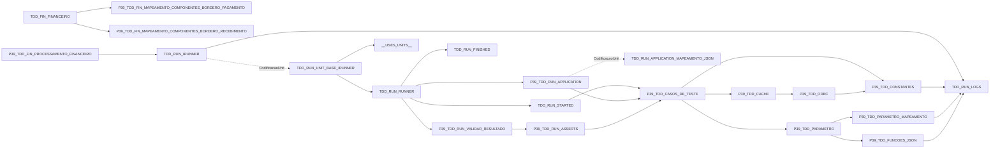

# Dependencias uses reconciliadas

Setas continuas representam uses; setas pontilhadas representam carga dinamica. Os hashes normalizam somente CRLF/LF. Estado compartilhado e APIs nativas nao sao inferidos como uses.
