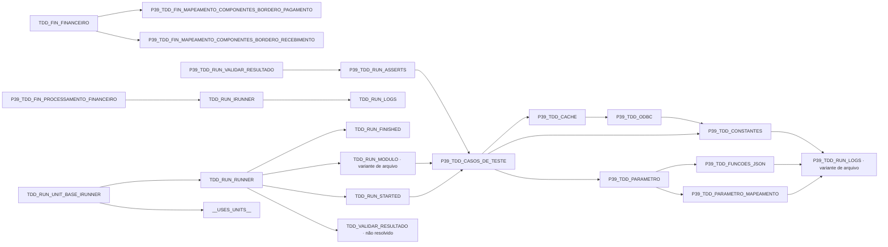

# Grafo AST de uses: TDD_RUN_IRUNNER, TDD_RUN_UNIT_BASE_IRUNNER, TDD_FIN_FINANCEIRO, P39_TDD_FIN_PROCESSAMENTO_FINANCEIRO, P39_TDD_RUN_VALIDAR_RESULTADO

Inventário: TDD_RUN_IRUNNER.ast.json. Somente cláusulas uses do fonte; comentários/literais são mascarados. Variantes P39_ são candidatas locais explícitas e não prova de cadastro remoto. Nós não resolvidos não recebem hash de um fonte de nome diferente. Carga dinâmica e estado compartilhado estão em mapas separados.
