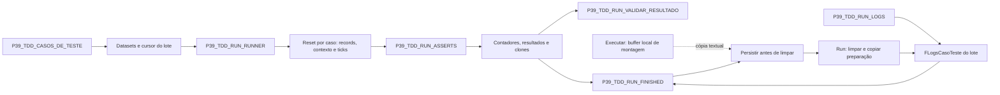

# Ciclo dos estados compartilhados

Executar restaura a referência anterior de logs e libera somente seu buffer. Main cria a lista do lote, liberada pelo próprio lote. FINISHED captura antes de Run limpar a tentativa; a preparação é copiada novamente para o próximo caso.
