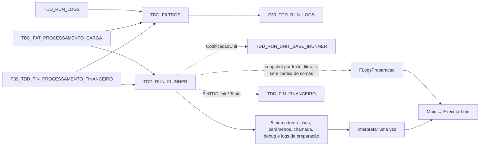

# Geração e interpretação única

Setas tracejadas representam seleção/carga dinâmica; não são cláusulas uses extraídas do AST.

Executar possui e libera seu buffer de montagem. Main cria a lista do lote e cada Run copia o texto de FLogsPreparacao antes de acrescentar as mensagens do caso. O diagnóstico exibido deixa o marcador de preparação vazio para evitar autorreferência; o código interpretado recebe o snapshot completo.
