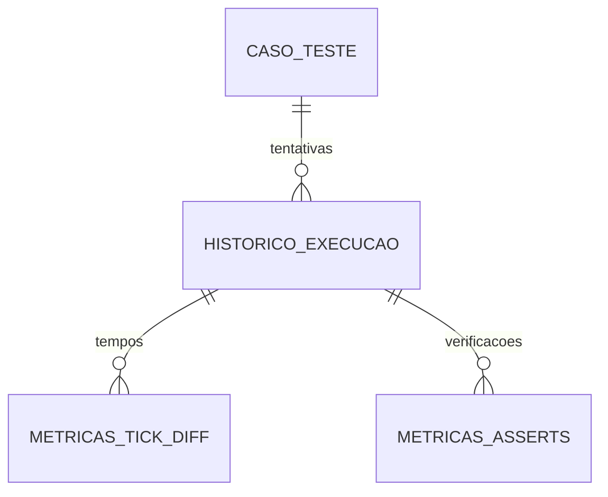

# Vínculo das métricas

O identificador retornado pelo INSERT do histórico é usado nos INSERTs das métricas. O diagrama descreve os vínculos usados pelo fluxo, não substitui uma inspeção das constraints do banco instalado.
